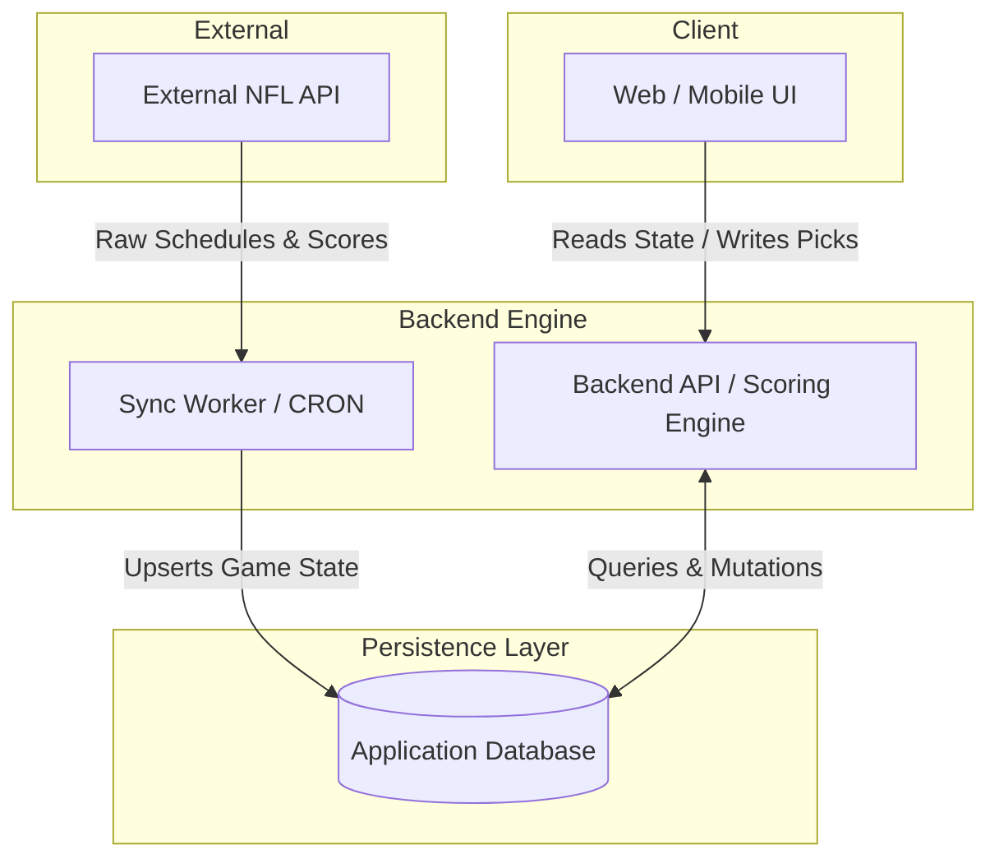

# ARCHITECTURE.md

## 1. System Topology & Component Diagram

The system follows a strictly decoupled 3-tier architecture. The client application never interacts directly with the external NFL data provider. All external data is asynchronously synced to the local database, ensuring the application remains fast and highly available even if the upstream API experiences downtime (stale-while-revalidate).



---

## 2. Relational Data Schema

The database serves as the absolute source of truth. All relations enforce strict uniqueness and auditability. Soft deletes (`status = 'INACTIVE'`) are used exclusively for pools and memberships to preserve historical leaderboard calculations.

### Core Tables

#### `users`
- **id** (UUID, Primary Key)
- **email** (String, Unique)
- **password_hash** (String)
- **role** (Enum: `ADMIN`, `USER`)
- **created_at** (Timestamp)

#### `pools`
- **id** (UUID, Primary Key)
- **name** (String)
- **admin_id** (UUID, Foreign Key -> `users.id`)
- **settings** (JSONB) - Stores point weights, dynamic lock offsets, penalty configs, tiebreaker rules, and anti-peeking/visibility configs.
- **status** (Enum: `ACTIVE`, `INACTIVE`)

#### `pool_memberships`
- **pool_id** (UUID, Foreign Key -> `pools.id`)
- **user_id** (UUID, Foreign Key -> `users.id`)
- **status** (Enum: `ACTIVE`, `INACTIVE`)
- *Primary Key*: `(pool_id, user_id)`

#### `games`
- **id** (UUID, Primary Key)
- **external_game_id** (String, Indexed) - Used for idempotent API reconciliation.
- **home_team_id** (String)
- **away_team_id** (String)
- **kickoff_time** (Timestamp) - Used as the strict `lock_at` threshold.
- **status** (Enum: `SCHEDULED`, `IN_PROGRESS`, `FINAL`)
- **home_score** (Int, Nullable)
- **away_score** (Int, Nullable)
- **commissioner_notes** (String, Nullable) - Admin-curated matchup notes/context.

#### `picks`
- **id** (UUID, Primary Key)
- **pool_id** (UUID, Foreign Key -> `pools.id`)
- **user_id** (UUID, Foreign Key -> `users.id`)
- **game_id** (UUID, Foreign Key -> `games.id`)
- **selected_team_id** (String, Nullable) - `NULL` indicates an omitted pick.
- **submitted_by** (UUID, Foreign Key -> `users.id`) - Tracks if the user or an admin entered the pick.
- **created_at** (Timestamp)
- *Constraint*: `UNIQUE(pool_id, user_id, game_id)`

#### `pick_results` (Immutable)
- **pick_id** (UUID, Primary Key, Foreign Key -> `picks.id`)
- **is_correct** (Boolean)
- **points_awarded** (Decimal(5,2)) - Standardized precision decimal for weighted and custom point values.
- **finalized_at** (Timestamp)

#### `audit_logs` (Append-Only)
- **id** (UUID, Primary Key)
- **actor_id** (UUID, Foreign Key -> `users.id`)
- **action** (String) - e.g., `"ADMIN_OVERRIDE_PICK"`
- **target_entity_id** (UUID)
- **old_value** (JSONB)
- **new_value** (JSONB)
- **timestamp** (Timestamp)

### Extended Tables (Penalty Engine & Precision Tiebreakers)

#### `pool_member_stats` (Cumulative Cache)
- **pool_id** (UUID, Foreign Key -> `pools.id`)
- **user_id** (UUID, Foreign Key -> `users.id`)
- **total_shots_drank** (Decimal(5,2), Default: `0.00`) - Precision cumulative metric supporting fractional/split penalties.
- **first_place_finishes** (Int, Default: `0`)
- **dead_place_finishes** (Int, Default: `0`)
- **updated_at** (Timestamp)
- *Primary Key*: `(pool_id, user_id)`

#### `penalty_ledger` (Audit & Transactions)
- **id** (UUID, Primary Key)
- **pool_id** (UUID, Foreign Key -> `pools.id`)
- **user_id** (UUID, Foreign Key -> `users.id`)
- **week_number** (Int, Nullable)
- **delta** (Decimal(5,2)) - Exact integer or fractional penalty delta (e.g., `0.50` shots for split dead place).
- **reason** (String) - e.g., `'WEEKLY_DEAD_PLACE'`, `'LOSS_INCREMENT'`, `'ADMIN_ADJUSTMENT'`
- **created_by** (UUID, Foreign Key -> `users.id`)
- **created_at** (Timestamp)
- *Index*: `(pool_id, user_id)`

#### `weekly_submissions` (Draft & Tiebreaker Tracker)
- **id** (UUID, Primary Key)
- **pool_id** (UUID, Foreign Key -> `pools.id`)
- **user_id** (UUID, Foreign Key -> `users.id`)
- **week_number** (Int)
- **tie_breaker_prediction** (Decimal(5,2), Nullable) - User's predicted total points for the designated tiebreaker game.
- **is_finalized** (Boolean, Default: `false`) - Tracks draft vs. locked pick state for visibility.
- **created_at** (Timestamp)
- **updated_at** (Timestamp)
- *Constraint*: `UNIQUE(pool_id, user_id, week_number)`
- *Index*: `(pool_id, week_number, is_finalized)`

#### `penalty_media` (Shot-Cam Storage)
- **id** (UUID, Primary Key)
- **penalty_id** (UUID, Unique Foreign Key -> `penalty_ledger.id`)
- **pool_id** (UUID, Foreign Key -> `pools.id`)
- **user_id** (UUID, Foreign Key -> `users.id`)
- **storage_path** (String) - Supabase bucket path.
- **media_type** (String) - e.g., `'image/jpeg'`, `'video/mp4'`
- **status** (Enum: `PENDING`, `CONFIRMED`, `REJECTED`)
- **confirmed_by** (UUID, Nullable)
- **created_at** (Timestamp)
- *Index*: `(pool_id, user_id)`

### `pools.settings` JSON Schema Extension

```json
{
  "$schema": "[http://json-schema.org/draft-07/schema#](http://json-schema.org/draft-07/schema#)",
  "type": "object",
  "properties": {
    "lock_offset": {
      "type": "integer",
      "minimum": 0,
      "default": 0,
      "description": "Lock offset threshold in minutes prior to kickoff"
    },
    "lockMode": {
      "enum": ["ROLLING", "GLOBAL_FIRST_GAME"],
      "default": "ROLLING"
    },
    "excludedGameWindows": {
      "type": "array",
      "items": { "type": "string" },
      "default": []
    },
    "points_per_win": {
      "type": "number",
      "minimum": 0,
      "default": 1.0,
      "description": "Points awarded per winning pick (Decimal(5,2) precision)"
    },
    "picking_mode": {
      "type": "string",
      "enum": ["STRAIGHT_UP", "SPREAD"],
      "default": "STRAIGHT_UP",
      "description": "Mode of pick submission and scoring evaluation"
    },
    "hide_picks_until_kickoff": {
      "type": "boolean",
      "default": true,
      "description": "Enables anti-peeking pick masking before game kickoff"
    },
    "anti_peeking": {
      "type": "object",
      "properties": {
        "enabled": { "type": "boolean", "default": true },
        "reveal_at": {
          "type": "string",
          "enum": ["LOCK_TIME", "GAME_FINAL"],
          "default": "LOCK_TIME"
        }
      }
    },
    "tiebreaker": {
      "type": "object",
      "properties": {
        "enabled": { "type": "boolean", "default": true },
        "game_target": {
          "type": "string",
          "enum": ["LAST_GAME", "MONDAY_NIGHT", "CUSTOM"],
          "default": "MONDAY_NIGHT"
        },
        "allow_decimals": { "type": "boolean", "default": true },
        "rule": {
          "type": "string",
          "enum": ["CLOSEST_ABSOLUTE", "CLOSEST_WITHOUT_GOING_OVER"],
          "default": "CLOSEST_ABSOLUTE"
        }
      }
    },
    "penalties": {
      "type": "object",
      "required": ["penalty_name", "shots_per_loss", "dead_place_penalty", "tie_handling"],
      "properties": {
        "penalty_name": { "type": "string", "default": "shot" },
        "shots_per_loss": { "type": "integer", "minimum": 0, "default": 0 },
        "dead_place_penalty": { "type": "integer", "minimum": 1, "default": 1 },
        "tie_handling": {
          "type": "string",
          "enum": ["ALL_TIED", "TIEBREAKER_ONLY", "SPLIT_PENALTY"],
          "default": "ALL_TIED"
        }
      }
    }
  }
}
```

---

## 3. State Machine & Lifecycle Specifications

### 3.1 Game Lock Lifecycle
- **Pre-Game (`SCHEDULED`):** Picks can be created, updated, or deleted. The UI evaluates `games.kickoff_time` minus the pool's `lock_offset` (from `pools.settings`) to determine if the submission window is open.
- **Lock Execution:** The backend API rejects any `POST` / `PUT` requests to the `picks` table where the current server time is greater than or equal to the calculated lock time. 
  - If `lockMode === 'ROLLING'`, granular locking is enforced per-game.
  - If `lockMode === 'GLOBAL_FIRST_GAME'`, submittals across all weekly games are rejected after the week's first kickoff.
- **In-Progress (`IN_PROGRESS`):** External API sync worker updates live scores periodically. UI can display live projections, but official scores are not written.

### 3.2 Scoring Finalization Lifecycle
1. The External API reports a game as complete.
2. The Sync Worker updates the `games` table: `status = 'FINAL'`, setting final `home_score` and `away_score`.
3. The Backend Scoring Engine is triggered.
4. **Scoring Exclusion Pipeline:** The engine checks `pools.settings.excludedGameWindows`. Any game falling within an excluded window (e.g., `THURSDAY_NIGHT`) is skipped and zero points are allocated.
5. The Engine evaluates all picks for that `game_id` (unsubmitted or `NULL` picks resolve gracefully to 0 points).
6. The Engine calculates points based on `pools.settings` and writes records with `Decimal(5,2)` precision to the `pick_results` table.
7. **Immutability:** Once a `pick_result` is written, it is static. Historical scores are read directly from `pick_results`.

### 3.3 Weekly Finalization Pipeline & Tiebreaker Engine
- **Trigger Condition:** Executes when all scheduled games for `week_no` have `status = 'FINAL'`.
- **Locking:** Acquires a transactional lock to prevent concurrent wrap-up executions.
- **Base Scoring & Tiebreaker Calculation:**
  1. Sum `points_awarded` for all members in the week.
  2. Identify the designated target game (`settings.tiebreaker.game_target`) and calculate actual total: `actual_total = (home_score + away_score)`.
  3. For each member, evaluate absolute distance: `distance = abs(actual_total - tie_breaker_prediction)`.
- **Precision Ranking:**
  - **Primary Sort:** Total points (DESC).
  - **Secondary Sort:** Tiebreaker distance (ASC).
- **Resolution & Fractional Penalties:**
  - Identifies **1st Place** (increments `first_place_finishes`).
  - Identifies **Dead Place**. If a Dead Place tie persists (identical points + identical distance), calculates `split_penalty = dead_place_penalty / count(tied_members)` and writes exact `Decimal(5,2)` values to `penalty_ledger`.
- **Stat Recalculation:** Atomically sums `penalty_ledger.delta` to update `pool_member_stats.total_shots_drank` (maintaining 2 decimal places).

### 3.4 Sync Failure Fallback
If the External NFL API goes offline, the Sync Worker logs a failure but the application remains fully operational. The frontend reads from the local `games` table (stale-while-revalidate strategy). Lock times and existing finalized scores remain intact.

---

## 4. API Specification & Data Masking

### Matrix Grid Endpoint (`GET /api/pools/:pool_id/matrix?week_no=X`)
Generates a structured 2D array representation of the week for UI rendering. Payload maps directly to rows (games), columns (users), and cells (the intersection pick). 

#### Dual-Mode Visibility & Anti-Peeking Rules
The Matrix API enforces strict data masking based on `pools.settings`:

- **Mode A (Strict/Hidden):** If `hide_picks_until_kickoff == true`, any pick where `game.kickoff_time > NOW()` belonging to another user (`requesting_user_id != target_user_id` and `role != 'ADMIN'`) is redacted. The pick's `selected_team_id` is mutated to `null` and a flag `is_masked: true` is appended.
- **Mode B (Open Slate):** If `hide_picks_until_kickoff == false`, picks are redacted ONLY if the opponent's `WeeklySubmission.is_finalized == false` (still a draft). Once a user finalizes their sheet (`is_finalized == true`), their picks become instantly exposed via `selected_team_id` to all pool members regardless of kickoff time.

---

## 5. Client-Side Determinism (The Snapshot Rule)

All UI Presets (`Contrarian`, `Mirror Rival`, `Favorites`, `Home/Away`) operate strictly in the browser.
- **Execution:** They compute purely as point-in-time form auto-fills in the browser.
- **No Binding:** Zero late-binding server synchronizations or relational bindings. User A mirroring User B on Tuesday creates static pick records. Subsequent mutations by User B prior to lock do not auto-propagate to User A.
- **Conditional Rules:** `Contrarian` and `Mirror Rival` presets are only enabled on the frontend when `hide_picks_until_kickoff === false`.

---

## 6. Audit & Compliance Implementation Details

- **Server-Side Enforcement:** Client-side validation is strictly advisory. The backend re-verifies all timestamps, roles, and ownership before committing transactions.
- **Admin Mutation Tracking:** If a pick is created or modified by an Admin overriding on behalf of a user, the `submitted_by` column on the `picks` table permanently records the Admin's ID.
- **Append-Only Logging:** Any destructive or overriding action performed by an Admin triggers an asynchronous write to the `audit_logs` table capturing `actor_id`, `action`, `target_entity_id`, `old_value`, and `new_value`.