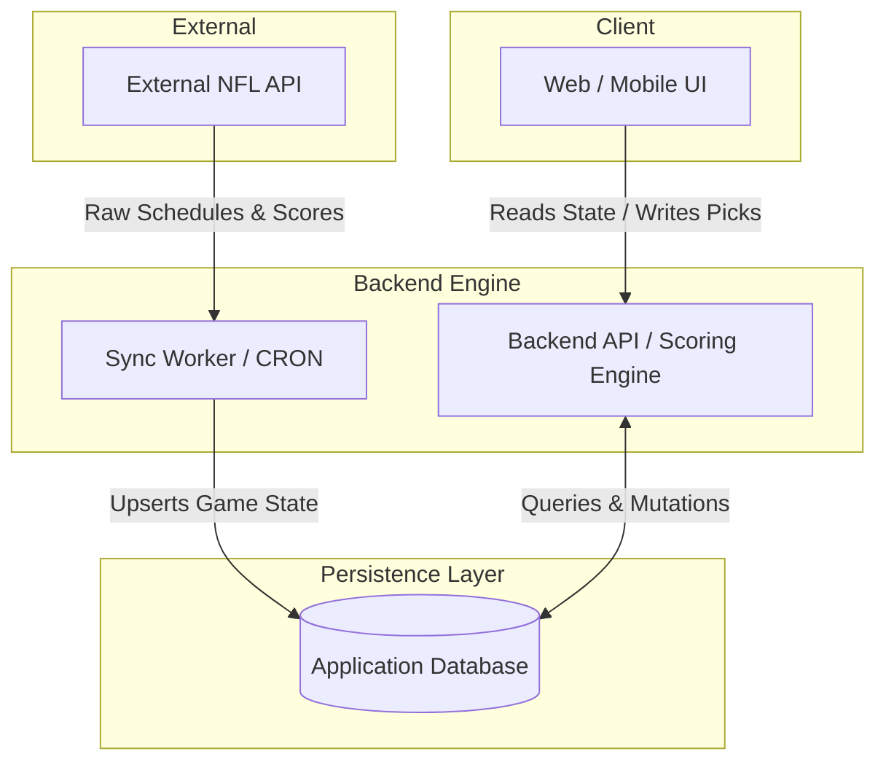

# ARCHITECTURE.md

## 1. System Topology & Component Diagram

The system follows a strictly decoupled 3-tier architecture. The client application never interacts directly with the external NFL data provider. All external data is asynchronously synced to the local database, ensuring the application remains fast and highly available even if the upstream API experiences downtime (stale-while-revalidate).



---

## 2. Relational Data Schema

The database serves as the absolute source of truth. All relations enforce strict uniqueness and auditability. Soft deletes (`status = 'INACTIVE'`) are used exclusively for pools and memberships to preserve historical leaderboard calculations.

### Core Tables

#### `users`
- **id** (UUID, Primary Key)
- **email** (String, Unique)
- **password_hash** (String)
- **role** (Enum: `ADMIN`, `USER`)
- **created_at** (Timestamp)

#### `pools`
- **id** (UUID, Primary Key)
- **name** (String)
- **admin_id** (UUID, Foreign Key -> `users.id`)
- **settings** (JSONB) - Stores point weights, dynamic lock offsets, penalty configs, and tiebreaker rules.
- **status** (Enum: `ACTIVE`, `INACTIVE`)

#### `pool_memberships`
- **pool_id** (UUID, Foreign Key -> `pools.id`)
- **user_id** (UUID, Foreign Key -> `users.id`)
- **status** (Enum: `ACTIVE`, `INACTIVE`)
- *Primary Key*: `(pool_id, user_id)`

#### `games`
- **id** (UUID, Primary Key)
- **external_game_id** (String, Indexed) - Used for idempotent API reconciliation.
- **home_team_id** (String)
- **away_team_id** (String)
- **kickoff_time** (Timestamp) - Used as the strict `lock_at` threshold.
- **status** (Enum: `SCHEDULED`, `IN_PROGRESS`, `FINAL`)
- **home_score** (Int, Nullable)
- **away_score** (Int, Nullable)

#### `picks`
- **id** (UUID, Primary Key)
- **pool_id** (UUID, Foreign Key -> `pools.id`)
- **user_id** (UUID, Foreign Key -> `users.id`)
- **game_id** (UUID, Foreign Key -> `games.id`)
- **selected_team_id** (String, Nullable) - `NULL` indicates an omitted pick.
- **submitted_by** (UUID, Foreign Key -> `users.id`) - Tracks if the user or an admin entered the pick.
- **created_at** (Timestamp)
- *Constraint*: `UNIQUE(pool_id, user_id, game_id)`

#### `pick_results` (Immutable)
- **pick_id** (UUID, Primary Key, Foreign Key -> `picks.id`)
- **is_correct** (Boolean)
- **points_awarded** (Decimal)
- **finalized_at** (Timestamp)

#### `audit_logs` (Append-Only)
- **id** (UUID, Primary Key)
- **actor_id** (UUID, Foreign Key -> `users.id`)
- **action** (String) - e.g., `"ADMIN_OVERRIDE_PICK"`
- **target_entity_id** (UUID)
- **old_value** (JSONB)
- **new_value** (JSONB)
- **timestamp** (Timestamp)

### Extended Tables (Penalty Engine)

#### `pool_member_stats` (Cumulative Cache)
- **pool_id** (UUID, Foreign Key -> `pools.id`)
- **user_id** (UUID, Foreign Key -> `users.id`)
- **total_shots_drank** (Int, Default: 0)
- **first_place_finishes** (Int, Default: 0)
- **dead_place_finishes** (Int, Default: 0)
- **updated_at** (Timestamp)
- *Primary Key*: `(pool_id, user_id)`

#### `penalty_ledger` (Audit & Transactions)
- **id** (UUID, Primary Key)
- **pool_id** (UUID, Foreign Key -> `pools.id`)
- **user_id** (UUID, Foreign Key -> `users.id`)
- **week_number** (Int, Nullable)
- **delta** (Int)
- **reason** (String) - e.g., `'WEEKLY_DEAD_PLACE'`, `'LOSS_INCREMENT'`, `'ADMIN_ADJUSTMENT'`
- **created_by** (UUID, Foreign Key -> `users.id`)
- **created_at** (Timestamp)
- *Index*: `(pool_id, user_id)`

### `pools.settings` JSON Schema Extension

```json
{
  "$schema": "http://json-schema.org/draft-07/schema#",
  "type": "object",
  "properties": {
    "penalties": {
      "type": "object",
      "required": ["penalty_name", "shots_per_loss", "dead_place_penalty", "tie_handling"],
      "properties": {
        "penalty_name": { "type": "string", "default": "shot" },
        "shots_per_loss": { "type": "integer", "minimum": 0, "default": 0 },
        "dead_place_penalty": { "type": "integer", "minimum": 1, "default": 1 },
        "tie_handling": {
          "type": "string",
          "enum": ["ALL_TIED", "TIEBREAKER_ONLY", "SPLIT_PENALTY"],
          "default": "ALL_TIED"
        }
      }
    }
  }
}
```

---

## 3. State Machine & Lifecycle Specifications

### 3.1 Game Lock Lifecycle
- **Pre-Game (`SCHEDULED`):** Picks can be created, updated, or deleted. The UI evaluates `games.kickoff_time` minus the pool's `lock_offset` (from `pools.settings`) to determine if the submission window is open.
- **Lock Execution:** The backend API rejects any `POST` / `PUT` requests to the `picks` table where the current server time is greater than or equal to the calculated lock time. Granular locking is enforced per-game, never batched by week.
- **In-Progress (`IN_PROGRESS`):** External API sync worker updates live scores periodically. UI can display live projections, but official scores are not written.

### 3.2 Scoring Finalization Lifecycle
1. The External API reports a game as complete.
2. The Sync Worker updates the `games` table: `status = 'FINAL'`, setting final `home_score` and `away_score`.
3. The Backend Scoring Engine is triggered.
4. The Engine evaluates all picks for that `game_id` (unsubmitted or `NULL` picks resolve gracefully to 0 points).
5. The Engine calculates points based on `pools.settings` and writes records to the `pick_results` table.
6. **Immutability:** Once a `pick_result` is written, it is static. Historical scores are read directly from `pick_results`.

### 3.3 Weekly Finalization Pipeline (New)
- **Trigger Condition:** Executes when all scheduled games for `week_no` have `status = 'FINAL'`.
- **Locking:** Acquires a transactional lock to prevent concurrent wrap-up executions.
- **Ranking:** Calculates weekly scores based on immutable `pick_results`.
- **Resolution:**
  - Identifies **1st Place** (increments `first_place_finishes`).
  - Identifies **Dead Place** (resolves ties via `settings.penalties.tie_handling`, increments `dead_place_finishes`).
- **Ledger Writing:** Writes the penalty delta to the `penalty_ledger` with reason `'WEEKLY_DEAD_PLACE'`.
- **Stat Recalculation:** Atomically sums `penalty_ledger.delta` to update `pool_member_stats.total_shots_drank`.

### 3.4 Sync Failure Fallback
If the External NFL API goes offline, the Sync Worker logs a failure but the application remains fully operational. The frontend reads from the local `games` table (stale-while-revalidate strategy). Lock times and existing finalized scores remain intact.

---

## 4. Audit & Compliance Implementation Details

- **Server-Side Enforcement:** Client-side validation is strictly advisory. The backend re-verifies all timestamps, roles, and ownership before committing transactions.
- **Admin Mutation Tracking:** If a pick is created or modified by an Admin overriding on behalf of a user, the `submitted_by` column on the `picks` table permanently records the Admin's ID.
- **Append-Only Logging:** Any destructive or overriding action performed by an Admin triggers an asynchronous write to the `audit_logs` table capturing `actor_id`, `action`, `target_entity_id`, `old_value`, and `new_value`.