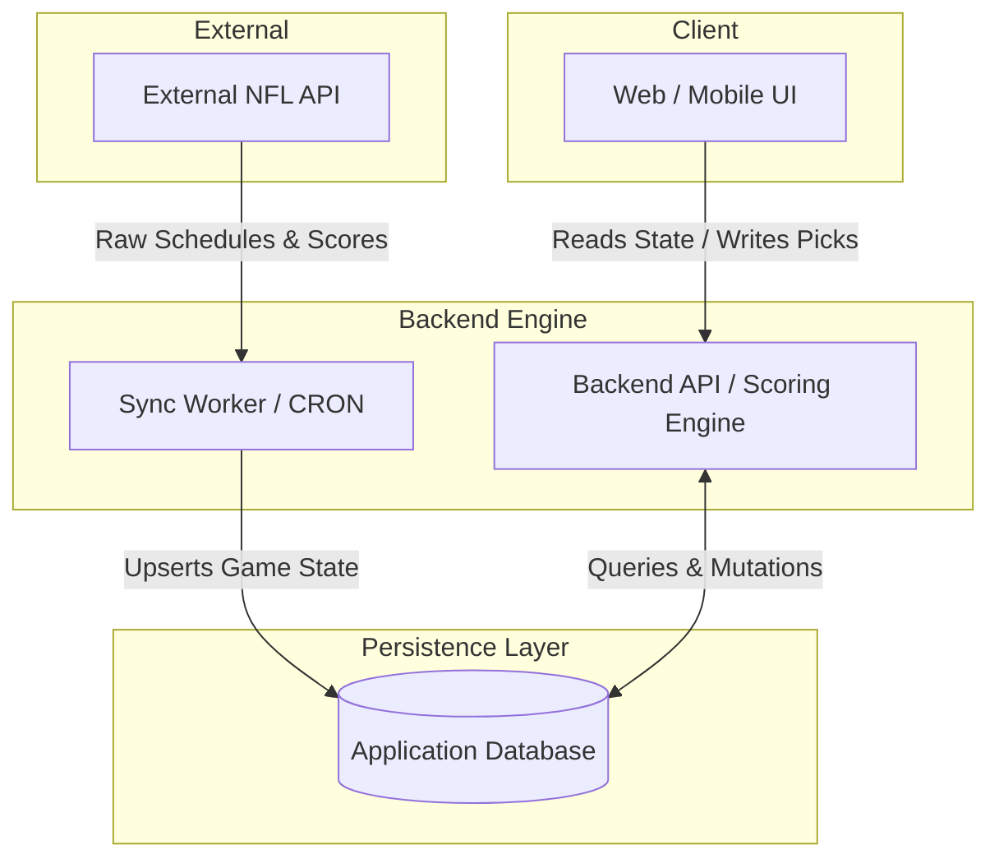

# R-12.2-C EVIDENCE BUNDLE
**Execution Timestamp:** 2026-10-02T20:47:27.808Z
**Target Branch:** `feat/phase12-1-outbox`
**Head Commit:** `af3c5fb1b0f7312f00f1c673e64c863cdd5bf65e`
**Generator Exit Code:** 0

---

## 1. Acceptance Matrix
### Step C Acceptance Matrix
- C.1 (Inbox List & Read Marker Routes): PASS
- C.2 (Read-Only Invariants / Decision #54): PASS
- C.3 (Row Ownership & 404 Masking): PASS
- C.4 (Preference Validation 1..5 / 1..168): PASS
- C.5 (Token-Based Unsubscribe): PASS
- C.6 (Full Test Suite 112/112 Passing): PASS
- C.7 (Clean Repository State at Stamped Commit): PASS

---

## 2. CI Verification & Controls

### 2.1 Decision Register CI Check (`node scripts/ci_check_register.js`)
- **Exit Code:** 0 (Expected: 0)
- **Output:**
```
✅ CI Check PASSED: Appendix A Decision Register exists byte-for-byte in ARCHITECTURE.md.
```

### 2.2 Working Tree Porcelain Hygiene
- **Clean Status:** YES (0 uncommitted tracked/untracked outside bundle)
- **Relevant Porcelain Lines:**
```
(clean)
```

---

## 3. Test Suite Execution & Negative Verification (`npm run test:db`)
- **Exit Code:** 0
- **Output:**
```
> nfl-pick-em@1.0.0 test:db
> npm run db:reset && npx prisma migrate deploy && npx prisma generate && node scripts/db_header.js && vitest --no-color


> nfl-pick-em@1.0.0 db:reset
> tsx scripts/dev/reset-rehearsal.mjs

=== RESET REHEARSAL DATABASE (Decision #35) ===

✅ URL Safety verified (localhost, no schema, pickem_rehearsal).
Terminating active connections to pickem_rehearsal...
Dropping and recreating pickem_rehearsal...
✅ pickem_rehearsal database recreated with timezone=UTC and app.disposable=true.
✅ Server sentinel app.disposable verified.
✅ Role 'anon' provisioned.
✅ Role 'authenticated' provisioned.
✅ Role 'service_role' provisioned.

--- Running prisma migrate deploy on pickem_rehearsal ---
Environment variables loaded from .env
Prisma schema loaded from prisma\schema.prisma
Datasource "db": PostgreSQL database "pickem_rehearsal", schema "public" at "localhost:5432"

9 migrations found in prisma/migrations

Applying migration `20260927000000_init`
Applying migration `20260928051824_add_pool_member_stats_and_penalty_ledger`
Applying migration `20260928124900_precision_and_weekly_submissions`
Applying migration `20260928170000_weekly_submission_finalized_and_game_notes`
Applying migration `20260928180000_shot_cam_penalty_media_and_rls`
Applying migration `20260929144500_br_1_ledger_append_only`
Applying migration `20260930010000_br_2b_ledger_api_lockdown`
Applying migration `20260930020000_br_2c_public_tables_api_lockdown`
Applying migration `20261001160000_12_1_a_outbox_inbox_core`

The following migration(s) have been applied:

migrations/
  └─ 20260927000000_init/
    └─ migration.sql
  └─ 20260928051824_add_pool_member_stats_and_penalty_ledger/
    └─ migration.sql
  └─ 20260928124900_precision_and_weekly_submissions/
    └─ migration.sql
  └─ 20260928170000_weekly_submission_finalized_and_game_notes/
    └─ migration.sql
  └─ 20260928180000_shot_cam_penalty_media_and_rls/
    └─ migration.sql
  └─ 20260929144500_br_1_ledger_append_only/
    └─ migration.sql
  └─ 20260930010000_br_2b_ledger_api_lockdown/
    └─ migration.sql
  └─ 20260930020000_br_2c_public_tables_api_lockdown/
    └─ migration.sql
  └─ 20261001160000_12_1_a_outbox_inbox_core/
    └─ migration.sql
      
All migrations have been successfully applied.

Applied Migrations:
┌─────────┬─────────────────────────────────────────────────────────────┬──────────────────────────┐
│ (index) │ migration_name                                              │ finished_at              │
├─────────┼─────────────────────────────────────────────────────────────┼──────────────────────────┤
│ 0       │ '20260927000000_init'                                       │ 2026-10-02T20:47:36.598Z │
│ 1       │ '20260928051824_add_pool_member_stats_and_penalty_ledger'   │ 2026-10-02T20:47:36.637Z │
│ 2       │ '20260928124900_precision_and_weekly_submissions'           │ 2026-10-02T20:47:36.678Z │
│ 3       │ '20260928170000_weekly_submission_finalized_and_game_notes' │ 2026-10-02T20:47:36.687Z │
│ 4       │ '20260928180000_shot_cam_penalty_media_and_rls'             │ 2026-10-02T20:47:36.709Z │
│ 5       │ '20260929144500_br_1_ledger_append_only'                    │ 2026-10-02T20:47:36.727Z │
│ 6       │ '20260930010000_br_2b_ledger_api_lockdown'                  │ 2026-10-02T20:47:36.733Z │
│ 7       │ '20260930020000_br_2c_public_tables_api_lockdown'           │ 2026-10-02T20:47:36.739Z │
│ 8       │ '20261001160000_12_1_a_outbox_inbox_core'                   │ 2026-10-02T20:47:36.788Z │
└─────────┴─────────────────────────────────────────────────────────────┴──────────────────────────┘
weekly_wrapups exists in public: false (Expected: false)
Environment variables loaded from .env
Prisma schema loaded from prisma\schema.prisma
Datasource "db": PostgreSQL database "pickem_rehearsal", schema "public" at "localhost:5432"

9 migrations found in prisma/migrations


No pending migrations to apply.
Environment variables loaded from .env
Prisma schema loaded from prisma\schema.prisma

✔ Generated Prisma Client (v5.22.0) to .\node_modules\@prisma\client in 228ms

Start by importing your Prisma Client (See: https://pris.ly/d/importing-client)

Tip: Curious about the SQL queries Prisma ORM generates? Optimize helps you enhance your visibility: https://pris.ly/tip-2-optimize

=== DB Header & Rehearsal Verification ===

1. Database Identity:
[
  {
    "current_database": "pickem_rehearsal",
    "current_user": "postgres",
    "inet_server_addr": "::1",
    "inet_server_port": 5432
  }
]

2. Applied Migrations:
[
  {
    "migration_name": "20260927000000_init",
    "started_at": "2026-10-02T20:47:36.513Z",
    "finished_at": "2026-10-02T20:47:36.598Z",
    "applied_steps_count": 1
  },
  {
    "migration_name": "20260928051824_add_pool_member_stats_and_penalty_ledger",
    "started_at": "2026-10-02T20:47:36.600Z",
    "finished_at": "2026-10-02T20:47:36.637Z",
    "applied_steps_count": 1
  },
  {
    "migration_name": "20260928124900_precision_and_weekly_submissions",
    "started_at": "2026-10-02T20:47:36.639Z",
    "finished_at": "2026-10-02T20:47:36.678Z",
    "applied_steps_count": 1
  },
  {
    "migration_name": "20260928170000_weekly_submission_finalized_and_game_notes",
    "started_at": "2026-10-02T20:47:36.679Z",
    "finished_at": "2026-10-02T20:47:36.687Z",
    "applied_steps_count": 1
  },
  {
    "migration_name": "20260928180000_shot_cam_penalty_media_and_rls",
    "started_at": "2026-10-02T20:47:36.688Z",
    "finished_at": "2026-10-02T20:47:36.709Z",
    "applied_steps_count": 1
  },
  {
    "migration_name": "20260929144500_br_1_ledger_append_only",
    "started_at": "2026-10-02T20:47:36.711Z",
    "finished_at": "2026-10-02T20:47:36.727Z",
    "applied_steps_count": 1
  },
  {
    "migration_name": "20260930010000_br_2b_ledger_api_lockdown",
    "started_at": "2026-10-02T20:47:36.728Z",
    "finished_at": "2026-10-02T20:47:36.733Z",
    "applied_steps_count": 1
  },
  {
    "migration_name": "20260930020000_br_2c_public_tables_api_lockdown",
    "started_at": "2026-10-02T20:47:36.735Z",
    "finished_at": "2026-10-02T20:47:36.739Z",
    "applied_steps_count": 1
  },
  {
    "migration_name": "20261001160000_12_1_a_outbox_inbox_core",
    "started_at": "2026-10-02T20:47:36.741Z",
    "finished_at": "2026-10-02T20:47:36.788Z",
    "applied_steps_count": 1
  }
]

3. Prisma Migrate Status:
Environment variables loaded from .env
Prisma schema loaded from prisma\schema.prisma
Datasource "db": PostgreSQL database "pickem_rehearsal", schema "public" at "localhost:5432"

9 migrations found in prisma/migrations

Database schema is up to date!

 RUN  v5.0.2 C:/Users/kacone/Documents/AI and Tech/Antigravity/NFL Pick Em

stdout | tests/br5b_routes.test.ts > BR-5b: Admin Picks Routes Scoping & Decision #49 CI Route Scan > S-7: Shot-Cam Media Routes Scoping (No Global Admin Bypass) > POST /api/pools/:pool_id/penalties/:id/media: global ADMIN who is neither owner nor commissioner -> 403
penalty_media row count = 0

stdout | tests/br5b_routes.test.ts > BR-5b: Admin Picks Routes Scoping & Decision #49 CI Route Scan > S-7: Shot-Cam Media Routes Scoping (No Global Admin Bypass) > POST /api/pools/:pool_id/penalties/:id/media: member who is NOT the penalty owner -> 403
penalty_media row count = 0

stdout | tests/br5b_routes.test.ts > BR-5b: Admin Picks Routes Scoping & Decision #49 CI Route Scan > S-7: Shot-Cam Media Routes Scoping (No Global Admin Bypass) > verifies zero penalty_media rows exist after denied upload attempts
penalty_media row count = 0

stdout | tests/br5b_routes.test.ts > BR-5b: Admin Picks Routes Scoping & Decision #49 CI Route Scan > S-7: Shot-Cam Media Routes Scoping (No Global Admin Bypass) > PATCH /api/pools/:pool_id/penalties/:id/media/confirm: global ADMIN who is not commissioner -> 403
penalty_media row count = 0

stdout | tests/br5b_routes.test.ts > BR-5b: Admin Picks Routes Scoping & Decision #49 CI Route Scan > S-8: GET /api/games Pool Scoping (No Pool Auto-Creation / Write-on-GET) > returns 404 POOL_NOT_FOUND when user is not member/commissioner of any pool and pool_id is omitted (no pool write)
pool count before = 1
pool count after = 1
pool count invariant = PASS

stdout | tests/br5b_routes.test.ts > BR-5b: Admin Picks Routes Scoping & Decision #49 CI Route Scan > S-8: GET /api/games Pool Scoping (No Pool Auto-Creation / Write-on-GET) > returns 404 POOL_NOT_FOUND when explicit pool_id does not exist (no pool write)
pool count before = 1
pool count after = 1
pool count invariant = PASS

stdout | tests/br5b_routes.test.ts > BR-5b: Admin Picks Routes Scoping & Decision #49 CI Route Scan > S-8: GET /api/games Pool Scoping (No Pool Auto-Creation / Write-on-GET) > returns 400 when explicit pool_id is not a valid UUID (no pool write)
pool count before = 1
pool count after = 1
pool count invariant = PASS

stdout | tests/br5b_routes.test.ts > BR-5b: Admin Picks Routes Scoping & Decision #49 CI Route Scan > S-8: GET /api/games Pool Scoping (No Pool Auto-Creation / Write-on-GET) > returns 403 when user is not a member or commissioner of the requested pool (no pool write)
pool count before = 1
pool count after = 1
pool count invariant = PASS

stdout | tests/br5b_routes.test.ts > BR-5b: Admin Picks Routes Scoping & Decision #49 CI Route Scan > S-8: GET /api/games Pool Scoping (No Pool Auto-Creation / Write-on-GET) > returns 200 with pool and games when pool_id is valid, with zero pool writes and identical schema snapshot
pool count before = 1
pool count after = 1
pool count invariant = PASS
member response byte equality = PASS
commissioner response byte equality = PASS

 ✓ tests/br5b_routes.test.ts (22 tests) 607ms
 ✓ tests/outbox_drain.test.ts (20 tests) 498ms
 ✓ tests/me_routes.test.ts (15 tests) 712ms
 ✓ tests/br2.test.ts (5 tests) 431ms
 ✓ tests/notifications.test.ts (10 tests) 205ms
 ✓ tests/br1.test.ts (6 tests) 206ms
 ✓ tests/br4b.test.ts (1 test) 158ms
 ✓ tests/authMiddleware.test.ts (21 tests) 18ms
 ✓ tests/characterization.test.ts (6 tests) 19ms
 ✓ tests/safeguards.test.ts (6 tests) 18ms

 Test Files  10 passed (10)
      Tests  112 passed (112)
   Start at  13:47:48
   Duration  7.73s (tests 53%, import 22%, setup 13%, transform 10%, worker 1%)

    Isolate  10 workers spawned · ~226ms startup each (spawn + environment, per file)
             at least ~2.03s faster with isolate: false — reuses workers across files instead of one per file


(node:1204) [MODULE_TYPELESS_PACKAGE_JSON] Warning: Module type of file:///C:/Users/kacone/Documents/AI%20and%20Tech/Antigravity/NFL%20Pick%20Em/scripts/db_header.js is not specified and it doesn't parse as CommonJS.
Reparsing as ES module because module syntax was detected. This incurs a performance overhead.
To eliminate this warning, add "type": "module" to \\?\C:\Users\kacone\Documents\AI and Tech\Antigravity\NFL Pick Em\package.json.
(Use `node --trace-warnings ...` to show where the warning was created)
(!) Your Vite config uses features that are unsupported by `configLoader: 'native'`, which is planned to become the default in a future major version of Vite:
  - ESM syntax in a file loaded as CommonJS (vitest.config.ts:1:1). Use a `.mjs` extension or set `"type": "module"` in the closest package.json
Set `VITE_CONFIG_NATIVE_IGNORE_WARNING=true` to suppress this warning.
stderr | tests/outbox_drain.test.ts > 12.1 Step B: Transport, Drain Worker, and Job Runners > withJobRun Lifecycle & Job Runners > database write failure does not fail or abort the underlying job execution
[withJobRun] Failed to create JobRun record for resilient_job: Error: DB Connection Lost
    at C:/Users/kacone/Documents/AI and Tech/Antigravity/NFL Pick Em/tests/outbox_drain.test.ts:458:63
    at file:///C:/Users/kacone/Documents/AI%20and%20Tech/Antigravity/NFL%20Pick%20Em/node_modules/vitest/dist/chunks/run.C5UmxDPh.js:1628:35
    at file:///C:/Users/kacone/Documents/AI%20and%20Tech/Antigravity/NFL%20Pick%20Em/node_modules/vitest/dist/chunks/run.C5UmxDPh.js:2783:26
    at file:///C:/Users/kacone/Documents/AI%20and%20Tech/Antigravity/NFL%20Pick%20Em/node_modules/vitest/dist/chunks/run.C5UmxDPh.js:3319:20
    at new Promise (<anonymous>)
    at runWithCancel (file:///C:/Users/kacone/Documents/AI%20and%20Tech/Antigravity/NFL%20Pick%20Em/node_modules/vitest/dist/chunks/run.C5UmxDPh.js:3314:10)
    at file:///C:/Users/kacone/Documents/AI%20and%20Tech/Antigravity/NFL%20Pick%20Em/node_modules/vitest/dist/chunks/run.C5UmxDPh.js:3299:20
    at new Promise (<anonymous>)
    at runWithTimeout (file:///C:/Users/kacone/Documents/AI%20and%20Tech/Antigravity/NFL%20Pick%20Em/node_modules/vitest/dist/chunks/run.C5UmxDPh.js:3257:10)
    at file:///C:/Users/kacone/Documents/AI%20and%20Tech/Antigravity/NFL%20Pick%20Em/node_modules/vitest/dist/chunks/run.C5UmxDPh.js:3876:64

stderr | tests/notifications.test.ts > 12.1 Core Schema & enqueueNotification Helper (INV-6 Compliant) > disallowed payload key is stripped
[notifications] Stripped unregistered payload key 'unauthorizedField' for notification type 'REMINDER'
[notifications] Stripped unregistered payload key 'extraBogusData' for notification type 'REMINDER'
```

---

## 4. LIVE REPOSITORY CONTEXT

### 4.1 Git Recent Log (5 Commits)
```
af3c5fb chore: update Step C generator shell execution
811ba94 chore: add Step C evidence generator and placeholder
954265e feat: Step C - inbox and notification preferences routes
53305b7 docs: bind reconciled B3 V2 evidence bundle
108de0f chore: add B3 V2 evidence generator
```

### 4.2 Prisma Schema (`prisma/schema.prisma`)
```prisma
datasource db {
  provider = "postgresql"
  url      = env("DATABASE_URL")
}

generator client {
  provider = "prisma-client-js"
}

enum Role {
  ADMIN
  USER
}

enum Status {
  ACTIVE
  INACTIVE
}

enum GameStatus {
  SCHEDULED
  IN_PROGRESS
  FINAL
}

enum PenaltyMediaStatus {
  PENDING
  CONFIRMED
  REJECTED
}

model User {
  id                     String                  @id @default(uuid()) @db.Uuid
  email                  String                  @unique
  passwordHash           String                  @map("password_hash")
  role                   Role                    @default(USER)
  createdAt              DateTime                @default(now()) @map("created_at")
  pools                  Pool[]                  @relation("AdministeredPools")
  memberships            PoolMembership[]
  picks                  Pick[]                  @relation("UserPicks")
  submittedPicks         Pick[]                  @relation("SubmittedPicks")
  auditLogs              AuditLog[]              @relation("UserAuditLogs")
  createdPenalties       PenaltyLedger[]         @relation("CreatedPenalties")
  weeklySubmissions      WeeklySubmission[]
  penaltyMedia           PenaltyMedia[]          @relation("UserPenaltyMedia")
  confirmedMedia         PenaltyMedia[]          @relation("ConfirmedPenaltyMedia")
  inboxMessages          InboxMessage[]
  outboxEventsReceived   OutboxEvent[]           @relation("OutboxEventRecipient")
  outboxEventsRetried    OutboxEvent[]           @relation("OutboxEventRetrier")
  notificationPreference NotificationPreference?

  @@map("users")
}

model Pool {
  id                String             @id @default(uuid()) @db.Uuid
  name              String
  adminId           String             @map("admin_id") @db.Uuid
  admin             User               @relation("AdministeredPools", fields: [adminId], references: [id])
  settings          Json
  status            Status             @default(ACTIVE)
  memberships       PoolMembership[]
  picks             Pick[]
  memberStats       PoolMemberStat[]
  penaltyLedger     PenaltyLedger[]
  weeklySubmissions WeeklySubmission[]
  penaltyMedia      PenaltyMedia[]
  inboxMessages     InboxMessage[]
  outboxEvents      OutboxEvent[]

  @@map("pools")
}

model PoolMembership {
  poolId String @map("pool_id") @db.Uuid
  userId String @map("user_id") @db.Uuid
  status Status @default(ACTIVE)

  pool Pool @relation(fields: [poolId], references: [id])
  user User @relation(fields: [userId], references: [id])

  stat              PoolMemberStat?
  penaltyLedger     PenaltyLedger[]
  weeklySubmissions WeeklySubmission[]

  @@id([poolId, userId])
  @@map("pool_memberships")
}

model Game {
  id                String     @id @default(uuid()) @db.Uuid
  externalGameId    String     @unique @map("external_game_id")
  homeTeamId        String     @map("home_team_id")
  awayTeamId        String     @map("away_team_id")
  kickoffTime       DateTime   @map("kickoff_time")
  status            GameStatus @default(SCHEDULED)
  homeScore         Int?       @map("home_score")
  awayScore         Int?       @map("away_score")
  commissionerNotes String?    @map("commissioner_notes")
  picks             Pick[]

  @@map("games")
}

model Pick {
  id             String      @id @default(uuid()) @db.Uuid
  poolId         String      @map("pool_id") @db.Uuid
  userId         String      @map("user_id") @db.Uuid
  gameId         String      @map("game_id") @db.Uuid
  selectedTeamId String?     @map("selected_team_id")
  submittedById  String      @map("submitted_by") @db.Uuid
  createdAt      DateTime    @default(now()) @map("created_at")

  pool        Pool        @relation(fields: [poolId], references: [id])
  user        User        @relation("UserPicks", fields: [userId], references: [id])
  game        Game        @relation(fields: [gameId], references: [id])
  submittedBy User        @relation("SubmittedPicks", fields: [submittedById], references: [id])
  result      PickResult?

  @@unique([poolId, userId, gameId])
  @@map("picks")
}

model PickResult {
  pickId        String   @id @map("pick_id") @db.Uuid
  isCorrect     Boolean  @map("is_correct")
  pointsAwarded Decimal  @map("points_awarded") @db.Decimal(5, 2)
  finalizedAt   DateTime @default(now()) @map("finalized_at")

  pick Pick @relation(fields: [pickId], references: [id], onDelete: Cascade)

  @@map("pick_results")
}

model AuditLog {
  id             String   @id @default(uuid()) @db.Uuid
  actorId        String   @map("actor_id") @db.Uuid
  action         String
  targetEntityId String   @map("target_entity_id")
  oldValue       Json?    @map("old_value")
  newValue       Json?    @map("new_value")
  timestamp      DateTime @default(now())

  actor User @relation("UserAuditLogs", fields: [actorId], references: [id])

  @@map("audit_logs")
}

model PoolMemberStat {
  poolId             String   @map("pool_id") @db.Uuid
  userId             String   @map("user_id") @db.Uuid
  totalShotsDrank    Decimal  @default(0.00) @map("total_shots_drank") @db.Decimal(5, 2)
  firstPlaceFinishes Int      @default(0) @map("first_place_finishes")
  deadPlaceFinishes  Int      @default(0) @map("dead_place_finishes")
  updatedAt          DateTime @default(now()) @updatedAt @map("updated_at")

  pool       Pool           @relation(fields: [poolId], references: [id], onDelete: Cascade)
  membership PoolMembership @relation(fields: [poolId, userId], references: [poolId, userId], onDelete: Cascade)

  @@id([poolId, userId])
  @@map("pool_member_stats")
}

model PenaltyLedger {
  id          String        @id @default(uuid()) @db.Uuid
  poolId      String        @map("pool_id") @db.Uuid
  userId      String        @map("user_id") @db.Uuid
  weekNumber  Int?          @map("week_number")
  delta       Decimal       @map("delta") @db.Decimal(5, 2)
  reason      String
  createdById String        @map("created_by") @db.Uuid
  createdAt   DateTime      @default(now()) @map("created_at")

  pool       Pool           @relation(fields: [poolId], references: [id], onDelete: Cascade)
  membership PoolMembership @relation(fields: [poolId, userId], references: [poolId, userId], onDelete: Cascade)
  createdBy  User           @relation("CreatedPenalties", fields: [createdById], references: [id])
  media      PenaltyMedia?

  @@index([poolId, userId])
  @@map("penalty_ledger")
}

model WeeklySubmission {
  id                   String   @id @default(uuid()) @db.Uuid
  poolId               String   @map("pool_id") @db.Uuid
  userId               String   @map("user_id") @db.Uuid
  weekNumber           Int      @map("week_number")
  tieBreakerPrediction Decimal? @map("tie_breaker_prediction") @db.Decimal(5, 2)
  isFinalized          Boolean  @default(false) @map("is_finalized")
  createdAt            DateTime @default(now()) @map("created_at")
  updatedAt            DateTime @default(now()) @updatedAt @map("updated_at")

  pool       Pool           @relation(fields: [poolId], references: [id], onDelete: Cascade)
  membership PoolMembership @relation(fields: [poolId, userId], references: [poolId, userId], onDelete: Cascade)
  user       User           @relation(fields: [userId], references: [id], onDelete: Cascade)

  @@unique([poolId, userId, weekNumber])
  @@index([poolId, weekNumber, isFinalized])
  @@map("weekly_submissions")
}

model PenaltyMedia {
  id          String             @id @default(uuid()) @db.Uuid
  penaltyId   String             @unique @map("penalty_id") @db.Uuid
  poolId      String             @map("pool_id") @db.Uuid
  userId      String             @map("user_id") @db.Uuid
  storagePath String             @map("storage_path")
  mediaType   String             @map("media_type")
  status      PenaltyMediaStatus @default(PENDING)
  confirmedBy String?            @map("confirmed_by") @db.Uuid
  createdAt   DateTime           @default(now()) @map("created_at")

  penalty   PenaltyLedger @relation(fields: [penaltyId], references: [id], onDelete: Cascade)
  pool      Pool          @relation(fields: [poolId], references: [id], onDelete: Cascade)
  user      User          @relation("UserPenaltyMedia", fields: [userId], references: [id], onDelete: Cascade)
  confirmer User?         @relation("ConfirmedPenaltyMedia", fields: [confirmedBy], references: [id])

  @@index([poolId, userId])
  @@map("penalty_media")
}

enum OutboxStatus {
  PENDING
  PROCESSING
  SENT
  FAILED
  DEAD
  SUPPRESSED
}

enum JobStatus {
  RUNNING
  OK
  PARTIAL
  FAILED
}

model InboxMessage {
  id        String    @id @default(uuid()) @db.Uuid
  poolId    String    @map("pool_id") @db.Uuid
  userId    String    @map("user_id") @db.Uuid
  type      String
  payload   Json
  dedupeKey String    @map("dedupe_key")
  readAt    DateTime? @map("read_at") @db.Timestamp(3)
  createdAt DateTime  @default(now()) @map("created_at") @db.Timestamp(3)

  pool Pool @relation(fields: [poolId], references: [id], onDelete: Restrict, onUpdate: Restrict)
  user User @relation(fields: [userId], references: [id], onDelete: Restrict, onUpdate: Restrict)

  @@unique([userId, dedupeKey])
  @@index([userId, readAt, createdAt])
  @@map("inbox_messages")
}

model OutboxEvent {
  id              String       @id @default(uuid()) @db.Uuid
  poolId          String       @map("pool_id") @db.Uuid
  recipientUserId String       @map("recipient_user_id") @db.Uuid
  type            String
  payload         Json
  dedupeKey       String       @unique @map("dedupe_key")
  status          OutboxStatus @default(PENDING)
  attempts        Int          @default(0)
  nextAttemptAt   DateTime     @default(now()) @map("next_attempt_at") @db.Timestamp(3)
  leaseExpiresAt  DateTime?    @map("lease_expires_at") @db.Timestamp(3)
  lastErrorCode   String?      @map("last_error_code")
  sentAt          DateTime?    @map("sent_at") @db.Timestamp(3)
  retriedBy       String?      @map("retried_by") @db.Uuid
  retriedAt       DateTime?    @map("retried_at") @db.Timestamp(3)
  createdAt       DateTime     @default(now()) @map("created_at") @db.Timestamp(3)

  pool      Pool  @relation(fields: [poolId], references: [id], onDelete: Restrict, onUpdate: Restrict)
  recipient User  @relation("OutboxEventRecipient", fields: [recipientUserId], references: [id], onDelete: Restrict, onUpdate: Restrict)
  retrier   User? @relation("OutboxEventRetrier", fields: [retriedBy], references: [id], onDelete: Restrict, onUpdate: Restrict)

  @@index([status, nextAttemptAt])
  @@map("outbox_events")
}

model NotificationPreference {
  userId               String   @id @map("user_id") @db.Uuid
  emailEnabled         Boolean  @default(true) @map("email_enabled")
  reminderOffsetsHours Int[]    @default([24, 2]) @map("reminder_offsets_hours")
  unsubscribeToken     String   @unique @default(uuid()) @map("unsubscribe_token")
  updatedAt            DateTime @updatedAt @map("updated_at") @db.Timestamp(3)

  user User @relation(fields: [userId], references: [id], onDelete: Restrict, onUpdate: Restrict)

  @@map("notification_preferences")
}

model JobRun {
  id             String    @id @default(uuid()) @db.Uuid
  jobName        String    @map("job_name")
  status         JobStatus
  startedAt      DateTime  @default(now()) @map("started_at") @db.Timestamp(3)
  finishedAt     DateTime? @map("finished_at") @db.Timestamp(3)
  itemsProcessed Int       @default(0) @map("items_processed")
  errorCode      String?   @map("error_code")
  meta           Json?

  @@index([jobName, startedAt])
  @@map("job_runs")
}
```

### 4.3 Architecture Document (`ARCHITECTURE.md`)
```markdown
# ARCHITECTURE.md

## 1. System Topology & Component Diagram

The system follows a strictly decoupled 3-tier architecture. The client application never interacts directly with the external NFL data provider. All external data is asynchronously synced to the local database, ensuring the application remains fast and highly available even if the upstream API experiences downtime (stale-while-revalidate).



---

## 2. Relational Data Schema

The database serves as the absolute source of truth. All relations enforce strict uniqueness and auditability. Soft deletes (`status = 'INACTIVE'`) are used exclusively for pools and memberships to preserve historical leaderboard calculations.

### Core Tables

#### `users`
- **id** (UUID, Primary Key)
- **email** (String, Unique)
- **password_hash** (String)
- **role** (Enum: `ADMIN`, `USER`)
- **created_at** (Timestamp)

#### `pools`
- **id** (UUID, Primary Key)
- **name** (String)
- **admin_id** (UUID, Foreign Key -> `users.id`)
- **settings** (JSONB) - Stores point weights, dynamic lock offsets, penalty configs, tiebreaker rules, and anti-peeking/visibility configs.
- **status** (Enum: `ACTIVE`, `INACTIVE`)

#### `pool_memberships`
- **pool_id** (UUID, Foreign Key -> `pools.id`)
- **user_id** (UUID, Foreign Key -> `users.id`)
- **status** (Enum: `ACTIVE`, `INACTIVE`)
- *Primary Key*: `(pool_id, user_id)`

#### `games`
- **id** (UUID, Primary Key)
- **external_game_id** (String, Indexed) - Used for idempotent API reconciliation.
- **home_team_id** (String)
- **away_team_id** (String)
- **kickoff_time** (Timestamp) - Used as the strict `lock_at` threshold.
- **status** (Enum: `SCHEDULED`, `IN_PROGRESS`, `FINAL`)
- **home_score** (Int, Nullable)
- **away_score** (Int, Nullable)
- **commissioner_notes** (String, Nullable) - Admin-curated matchup notes/context.

#### `picks`
- **id** (UUID, Primary Key)
- **pool_id** (UUID, Foreign Key -> `pools.id`)
- **user_id** (UUID, Foreign Key -> `users.id`)
- **game_id** (UUID, Foreign Key -> `games.id`)
- **selected_team_id** (String, Nullable) - `NULL` indicates an omitted pick.
- **submitted_by** (UUID, Foreign Key -> `users.id`) - Tracks if the user or an admin entered the pick.
- **created_at** (Timestamp)
- *Constraint*: `UNIQUE(pool_id, user_id, game_id)`

#### `pick_results` (Immutable)
- **pick_id** (UUID, Primary Key, Foreign Key -> `picks.id`)
- **is_correct** (Boolean)
- **points_awarded** (Decimal(5,2)) - Standardized precision decimal for weighted and custom point values.
- **finalized_at** (Timestamp)

#### `audit_logs` (Append-Only)
- **id** (UUID, Primary Key)
- **actor_id** (UUID, Foreign Key -> `users.id`)
- **action** (String) - e.g., `"ADMIN_OVERRIDE_PICK"`
- **target_entity_id** (UUID)
- **old_value** (JSONB)
- **new_value** (JSONB)
- **timestamp** (Timestamp)

### Extended Tables (Penalty Engine & Precision Tiebreakers)

#### `pool_member_stats` (Cumulative Cache)
- **pool_id** (UUID, Foreign Key -> `pools.id`)
- **user_id** (UUID, Foreign Key -> `users.id`)
- **total_shots_drank** (Decimal(5,2), Default: `0.00`) - Precision cumulative metric supporting fractional/split penalties.
- **first_place_finishes** (Int, Default: `0`)
- **dead_place_finishes** (Int, Default: `0`)
- **updated_at** (Timestamp)
- *Primary Key*: `(pool_id, user_id)`

#### `penalty_ledger` (Audit & Transactions)
- **id** (UUID, Primary Key)
- **pool_id** (UUID, Foreign Key -> `pools.id`)
- **user_id** (UUID, Foreign Key -> `users.id`)
- **week_number** (Int, Nullable)
- **delta** (Decimal(5,2)) - Exact integer or fractional penalty delta (e.g., `0.50` shots for split dead place).
- **reason** (String) - e.g., `'WEEKLY_DEAD_PLACE'`, `'LOSS_INCREMENT'`, `'ADMIN_ADJUSTMENT'`
- **created_by** (UUID, Foreign Key -> `users.id`)
- **created_at** (Timestamp)
- *Index*: `(pool_id, user_id)`

#### `weekly_submissions` (Draft & Tiebreaker Tracker)
- **id** (UUID, Primary Key)
- **pool_id** (UUID, Foreign Key -> `pools.id`)
- **user_id** (UUID, Foreign Key -> `users.id`)
- **week_number** (Int)
- **tie_breaker_prediction** (Decimal(5,2), Nullable) - User's predicted total points for the designated tiebreaker game.
- **is_finalized** (Boolean, Default: `false`) - Tracks draft vs. locked pick state for visibility.
- **created_at** (Timestamp)
- **updated_at** (Timestamp)
- *Constraint*: `UNIQUE(pool_id, user_id, week_number)`
- *Index*: `(pool_id, week_number, is_finalized)`

#### `penalty_media` (Shot-Cam Storage)
- **id** (UUID, Primary Key)
- **penalty_id** (UUID, Unique Foreign Key -> `penalty_ledger.id`)
- **pool_id** (UUID, Foreign Key -> `pools.id`)
- **user_id** (UUID, Foreign Key -> `users.id`)
- **storage_path** (String) - Supabase bucket path.
- **media_type** (String) - e.g., `'image/jpeg'`, `'video/mp4'`
- **status** (Enum: `PENDING`, `CONFIRMED`, `REJECTED`)
- **confirmed_by** (UUID, Nullable)
- **created_at** (Timestamp)
- *Index*: `(pool_id, user_id)`

### `pools.settings` JSON Schema Extension

```json
{
  "$schema": "[http://json-schema.org/draft-07/schema#](http://json-schema.org/draft-07/schema#)",
  "type": "object",
  "properties": {
    "lock_offset": {
      "type": "integer",
      "minimum": 0,
      "default": 0,
      "description": "Lock offset threshold in minutes prior to kickoff"
    },
    "lockMode": {
      "enum": ["ROLLING", "GLOBAL_FIRST_GAME"],
      "default": "ROLLING"
    },
    "excludedGameWindows": {
      "type": "array",
      "items": { "type": "string" },
      "default": []
    },
    "points_per_win": {
      "type": "number",
      "minimum": 0,
      "default": 1.0,
      "description": "Points awarded per winning pick (Decimal(5,2) precision)"
    },
    "picking_mode": {
      "type": "string",
      "enum": ["STRAIGHT_UP", "SPREAD"],
      "default": "STRAIGHT_UP",
      "description": "Mode of pick submission and scoring evaluation"
    },
    "hide_picks_until_kickoff": {
      "type": "boolean",
      "default": true,
      "description": "Enables anti-peeking pick masking before game kickoff"
    },
    "anti_peeking": {
      "type": "object",
      "properties": {
        "enabled": { "type": "boolean", "default": true },
        "reveal_at": {
          "type": "string",
          "enum": ["LOCK_TIME", "GAME_FINAL"],
          "default": "LOCK_TIME"
        }
      }
    },
    "tiebreaker": {
      "type": "object",
      "properties": {
        "enabled": { "type": "boolean", "default": true },
        "game_target": {
          "type": "string",
          "enum": ["LAST_GAME", "MONDAY_NIGHT", "CUSTOM"],
          "default": "MONDAY_NIGHT"
        },
        "allow_decimals": { "type": "boolean", "default": true },
        "rule": {
          "type": "string",
          "enum": ["CLOSEST_ABSOLUTE", "CLOSEST_WITHOUT_GOING_OVER"],
          "default": "CLOSEST_ABSOLUTE"
        }
      }
    },
    "penalties": {
      "type": "object",
      "required": ["penalty_name", "shots_per_loss", "dead_place_penalty", "tie_handling"],
      "properties": {
        "penalty_name": { "type": "string", "default": "shot" },
        "shots_per_loss": { "type": "integer", "minimum": 0, "default": 0 },
        "dead_place_penalty": { "type": "integer", "minimum": 1, "default": 1 },
        "tie_handling": {
          "type": "string",
          "enum": ["ALL_TIED", "TIEBREAKER_ONLY", "SPLIT_PENALTY"],
          "default": "ALL_TIED"
        }
      }
    }
  }
}
```

---

## 3. State Machine & Lifecycle Specifications

### 3.1 Game Lock Lifecycle
- **Pre-Game (`SCHEDULED`):** Picks can be created, updated, or deleted. The UI evaluates `games.kickoff_time` minus the pool's `lock_offset` (from `pools.settings`) to determine if the submission window is open.
- **Lock Execution:** The backend API rejects any `POST` / `PUT` requests to the `picks` table where the current server time is greater than or equal to the calculated lock time. 
  - If `lockMode === 'ROLLING'`, granular locking is enforced per-game.
  - If `lockMode === 'GLOBAL_FIRST_GAME'`, submittals across all weekly games are rejected after the week's first kickoff.
- **In-Progress (`IN_PROGRESS`):** External API sync worker updates live scores periodically. UI can display live projections, but official scores are not written.

### 3.2 Scoring Finalization Lifecycle
1. The External API reports a game as complete.
2. The Sync Worker updates the `games` table: `status = 'FINAL'`, setting final `home_score` and `away_score`.
3. The Backend Scoring Engine is triggered.
4. **Scoring Exclusion Pipeline:** The engine checks `pools.settings.excludedGameWindows`. Any game falling within an excluded window (e.g., `THURSDAY_NIGHT`) is skipped and zero points are allocated.
5. The Engine evaluates all picks for that `game_id` (unsubmitted or `NULL` picks resolve gracefully to 0 points).
6. The Engine calculates points based on `pools.settings` and writes records with `Decimal(5,2)` precision to the `pick_results` table.
7. **Immutability:** Once a `pick_result` is written, it is static. Historical scores are read directly from `pick_results`.

### 3.3 Weekly Finalization Pipeline & Tiebreaker Engine
- **Trigger Condition:** Executes when all scheduled games for `week_no` have `status = 'FINAL'`.
- **Locking:** Acquires a transactional lock to prevent concurrent wrap-up executions.
- **Base Scoring & Tiebreaker Calculation:**
  1. Sum `points_awarded` for all members in the week.
  2. Identify the designated target game (`settings.tiebreaker.game_target`) and calculate actual total: `actual_total = (home_score + away_score)`.
  3. For each member, evaluate absolute distance: `distance = abs(actual_total - tie_breaker_prediction)`.
- **Precision Ranking:**
  - **Primary Sort:** Total points (DESC).
  - **Secondary Sort:** Tiebreaker distance (ASC).
- **Resolution & Fractional Penalties:**
  - Identifies **1st Place** (increments `first_place_finishes`).
  - Identifies **Dead Place**. If a Dead Place tie persists (identical points + identical distance), calculates `split_penalty = dead_place_penalty / count(tied_members)` and writes exact `Decimal(5,2)` values to `penalty_ledger`.
- **Stat Recalculation:** Atomically sums `penalty_ledger.delta` to update `pool_member_stats.total_shots_drank` (maintaining 2 decimal places).

### 3.4 Sync Failure Fallback
If the External NFL API goes offline, the Sync Worker logs a failure but the application remains fully operational. The frontend reads from the local `games` table (stale-while-revalidate strategy). Lock times and existing finalized scores remain intact.

---

## 4. API Specification & Data Masking

### Matrix Grid Endpoint (`GET /api/pools/:pool_id/matrix?week_no=X`)
Generates a structured 2D array representation of the week for UI rendering. Payload maps directly to rows (games), columns (users), and cells (the intersection pick). 

#### Dual-Mode Visibility & Anti-Peeking Rules
The Matrix API enforces strict data masking based on `pools.settings`:

- **Mode A (Strict/Hidden):** If `hide_picks_until_kickoff == true`, any pick where `game.kickoff_time > NOW()` belonging to another user (`requesting_user_id != target_user_id` and `role != 'ADMIN'`) is redacted. The pick's `selected_team_id` is mutated to `null` and a flag `is_masked: true` is appended.
- **Mode B (Open Slate):** If `hide_picks_until_kickoff == false`, picks are redacted ONLY if the opponent's `WeeklySubmission.is_finalized == false` (still a draft). Once a user finalizes their sheet (`is_finalized == true`), their picks become instantly exposed via `selected_team_id` to all pool members regardless of kickoff time.

---

## 5. Client-Side Determinism (The Snapshot Rule)

All UI Presets (`Contrarian`, `Mirror Rival`, `Favorites`, `Home/Away`) operate strictly in the browser.
- **Execution:** They compute purely as point-in-time form auto-fills in the browser.
- **No Binding:** Zero late-binding server synchronizations or relational bindings. User A mirroring User B on Tuesday creates static pick records. Subsequent mutations by User B prior to lock do not auto-propagate to User A.
- **Conditional Rules:** `Contrarian` and `Mirror Rival` presets are only enabled on the frontend when `hide_picks_until_kickoff === false`.

---

## 6. Audit & Compliance Implementation Details

- **Server-Side Enforcement:** Client-side validation is strictly advisory. The backend re-verifies all timestamps, roles, and ownership before committing transactions.
- **Admin Mutation Tracking:** If a pick is created or modified by an Admin overriding on behalf of a user, the `submitted_by` column on the `picks` table permanently records the Admin's ID.
- **Append-Only Logging:** Any destructive or overriding action performed by an Admin triggers an asynchronous write to the `audit_logs` table capturing `actor_id`, `action`, `target_entity_id`, `old_value`, and `new_value`.

---

## Phase 12 — League Operations, Resilience & Season Lifecycle

### Resilient Outbox & Inbox Pattern
The system ensures non-blocking outbound network actions by persisting `InboxMessage` and `OutboxEvent` records within the same database transaction as the domain logic. 
- **Inbox:** DB-local source of truth.
- **Outbox:** Claimed by a drain worker using `FOR UPDATE SKIP LOCKED`. Uses exponential backoff and transitions to `DEAD` status after 5 failed delivery attempts. A MailTransport interface (with SMTP adapter) separates transport from logic.

### Worker Leases, Reminders & Job Health
- A stateless reminder scanner runs every ~10 minutes to detect unfinalized picks, keyed by `dedupeKey`, dynamically adjusting to schedule changes (flex moves). Payloads are allow-listed and never contain pick details.
- All sync, scoring, outbox-drain, and reminder-scan jobs log their executions to the `JobRun` table. The Commissioner Ops Health panel surfaces metrics such as `syncStale`, `outbox` status, and recent jobs.

### Audit & Correction Engine
The `AuditLog` table prevents `UPDATE` and `DELETE` via DB triggers. All corrections use compensating logic:
- **Overrides:** Commissioner-entered overrides preempt the sync engine, flagging `divergedFromProvider = true`.
- **Proposals:** Upstream sync changes on FINAL games generate a `ScoreCorrectionProposal`. If `outcomeChanged = false`, it applies automatically; otherwise, it requires commissioner approval.
- **Scoring Runs:** Always run a dry run diff, then apply via a unique `inputHash`. Points are derived state (recomputed).
- **Ledger Expansion:** `penalty_ledger` is expanded to include `entryType` (`ASSESSMENT`, `FULFILLMENT`, `WAIVER`, `REVERSAL`, `OPENING_BALANCE`) and `reversalOfId`. Updates are strictly additive. The outstanding balance is derived dynamically using the effect formula: `ASSESSMENT (+), OPENING_BALANCE (+), FULFILLMENT (-), WAIVER (-), REVERSAL (-effect(target))`. Negative balances are strictly blocked.

### Season State Machine & Seal Design
- **State Machine:** `SETUP` -> `ACTIVE` -> `FINALIZING` -> `CLOSED`.
- **Close-readiness:** Checks for un-finalized games, open proposals, runs, Shot-Cam verifications, and outstanding penalties.
- **Seal:** Moving to `CLOSED` generates a `SeasonSeal`: an immutable JSON snapshot with amounts stored as strings (e.g. `"0.00"`), a SHA256 checksum, and the selected carry-over policy (`CARRY`, `EXPIRE`, `WAIVE`). Reopening the season marks the seal `supersededAt` without deleting it.

### Rollover & Archive Model
- **Rollover:** Creates the next Season in `SETUP`, cloning rules with "review before activate" flags on exclusions/lockouts.
- **Carry-over:** `OPENING_BALANCE` entries propagate only for `CONFIRMED` users when the `CARRY` policy is executed.
- **Archive Read Model:** All history reads query the immutable `SeasonSeal` exclusively. Export features generate JSON/CSV bundles for `CLOSED` seasons only, guaranteeing that draft picks are never leaked.

---

## Phase 12 Design Decisions
1. **Points are derived; penalties are ledger:** Game scores recompute in-place; penalty counts require strictly additive transactions.
2. **Provider corrections are proposals:** Auto-apply only occurs when no outcome changes.
3. **Overrides beat sync:** Divergence from the data provider is explicitly flagged.
4. **Locks derive from stored kickoff only:** Sync outages never unlock a game.
5. **Inbox is the source of truth:** Email delivery is strictly best-effort outbox logic.
6. **Aggregates are never stored numerically:** Sealed season JSONs use fixed-string representations for balances.
7. **Pick-on-behalf is write-only:** Admins cannot scrape user drafts prior to locking via exception logs.
8. **History reads seals only:** Historical dashboards and exports never query the live relational tables.
9. **Ledger `entryType` is additive and parallel to `reason` (Ruling R-12.2-A):** 
   - `entryType` is added as a NEW column alongside existing `reason`. `reason` is NOT replaced, renamed, or dropped.
   - `reason` = cause/rule code (why). `entryType` = balance effect (what). Balance logic MUST NOT read `reason`.
   - Backfill is achieved via the column DEFAULT only. The migration MUST NOT contain any `UPDATE` and MUST NOT disable, drop, or alter the immutability trigger (INV-2).
   - Non-ASSESSMENT write paths remain disabled behind a feature flag until the read-path audit passes.
   - Reversal-of-reversal is forbidden. A REVERSAL may only target a non-REVERSAL entry with the same league, season, and user, and equal amount.
10. **Physical schema names govern (Ruling R-12.2-B):** Logical names in handoffs are documentation only. The system strictly maps to the existing physical table `penalty_ledger` and the amount column `delta`.
11. **Ledger `delta` semantics:** `delta` is a strictly positive Decimal(5,2) magnitude. The sign (+/-) is derived entirely from `entry_type`. Balance settlement logic must never read the `reason` column.
12. **Ruling R-12.2-C / BR-1 Remediation:**
   - **INV-2 Enforcement:** A database-level PL/pgSQL function and trigger (`enforce_append_only`) physically prevents `UPDATE`, `DELETE`, and `TRUNCATE` operations on `penalty_ledger`. This is deployed out-of-band (BR-1).
   - **Schema Identifiers:** `reversal_of_id` must use the `uuid` data type (matching `penalty_ledger.id`).
   - **Naming Convention:** `snake_case` strictly applied for all new database columns, constraints, and index names. Prisma fields use `camelCase` mapped via `@map`. Enums use `UPPER_CASE`.
   - **Advisory Locks:** Any typed ledger writes that reduce or reverse balances (e.g., `FULFILLMENT`, `WAIVER`, `REVERSAL`) MUST acquire a transaction-scoped advisory lock serialized by `pool_id` and `user_id`.
13. **Ledger-bearing deletion:** Pools and memberships carrying a ledger are never hard-deleted (archive/soft-delete only).
14. **Season ≡ Pool:** No duplicate `Season` table is created. All Phase 12 references to `seasonId` / `leagueId` map to `pool_id`.
15. **Deny-by-Default Data API:** Every Phase 12 table ships deny-by-default to Data API roles.
16. **Money Input Parsing:** Ledger money input is parsed by one strict shared parser; `parseInt`, `parseFloat`, and `Number` are never used.
17. **Evidence Reporting Standard:** Every evidence report must state the host class, database, current_user, and server version.
18. **Disposable Rehearsal DB:** All destructive work occurs on a disposable rehearsal database first. Hosted environments receive `migrate deploy` only.
19. **Signed Legacy Assessment:** Legacy ASSESSMENT rows may carry a signed delta, but typed rows moving forward are always positive.
20. **Pool-Scoped Authority:** Authority is derived from `pools.admin_id` and a pool-scoped co-commissioner membership flag; global Roles are never used to authorize pool-specific operations.
21. **Authorization Defect Fixes:** BR-5 authorization fixes are code-only and strictly precede any new commissioner endpoints.
22. **Decimal-Only Money Math:** Money splitting is Decimal-only; the ledger never receives `delta = 0`. Characterization tests are required before changes.
23. **Invariant Evidence Status:** Every invariant carries an evidence status; Phase 12 acceptance may not assume more than the register states.
24. **Idempotent Period-Close:** Idempotent period-close is enforced via a DB-enforced claim in the same transaction.
25. **Acceptance Tests Assert Behavior:** Acceptance tests assert behavior (SQLSTATE, row state), never message text.
26. **Guarded Read Routes:** Read routes are guarded exactly like write routes (uuid -> pool exists -> commissioner or ACTIVE member); guards change access, never payloads.
27. **Period-Close Preconditions:** Period-close preconditions are evaluated from authoritative state; empty sets fail closed; no bypass flag.

### BR-4b Idempotency Design
- A new table `weekly_wrapups` serves as a claim table to enforce idempotency during period-close.
- A unique index on `penalty_ledger` was **REJECTED** because it would break the REVERSAL + new ASSESSMENT correction flow.
- Consequences:
  1. Concurrent wrap-ups block on the primary key, avoiding duplicate writes.
  2. The claim occurs as the first statement in the transaction.
  3. `skipDuplicates: true` returns a count of 0 on duplicates, translating to a `409 ALREADY_WRAPPED_UP` without throwing an unhandled Prisma constraint error.
- **SQL Implementation:**
```sql
CREATE TABLE weekly_wrapups (
  pool_id      uuid          NOT NULL,
  week_number  integer       NOT NULL,
  created_at   timestamp(3)  NOT NULL DEFAULT CURRENT_TIMESTAMP,
  CONSTRAINT weekly_wrapups_pkey PRIMARY KEY (pool_id, week_number),
  CONSTRAINT weekly_wrapups_pool_id_fkey FOREIGN KEY (pool_id)
    REFERENCES pools(id) ON DELETE RESTRICT ON UPDATE RESTRICT
);

INSERT INTO weekly_wrapups (pool_id, week_number)
SELECT DISTINCT pool_id, week_number
FROM penalty_ledger
WHERE reason = 'WEEKLY_DEAD_PLACE' AND week_number IS NOT NULL
ON CONFLICT DO NOTHING;

CREATE FUNCTION weekly_wrapups_prevent_mutation() RETURNS trigger
LANGUAGE plpgsql AS $$
BEGIN
  RAISE EXCEPTION 'append-only violation: % on weekly_wrapups is not permitted (INV-2)', TG_OP;
END; $$;

CREATE TRIGGER weekly_wrapups_no_update_delete
  BEFORE UPDATE OR DELETE ON weekly_wrapups
  FOR EACH ROW EXECUTE FUNCTION weekly_wrapups_prevent_mutation();
CREATE TRIGGER weekly_wrapups_no_truncate
  BEFORE TRUNCATE ON weekly_wrapups
  FOR EACH STATEMENT EXECUTE FUNCTION weekly_wrapups_prevent_mutation();

REVOKE ALL ON FUNCTION weekly_wrapups_prevent_mutation() FROM PUBLIC, anon, authenticated;
REVOKE ALL ON TABLE weekly_wrapups FROM anon, authenticated;
ALTER TABLE weekly_wrapups ENABLE ROW LEVEL SECURITY;
```

### Ruling R-12.2-E Errata & Updates
- **Environment Naming:** "postgres" is a DB name, not an environment; `postgres.<project-ref>` indicates a hosted pooler connection.
- **BR-1 Test 6 Finding:** Test 6 caught a `23503` (FK violation), not the append-only `P0001` error.
- **INV-1 Validation:** DB-level `numeric(5,2)` exactly verified against the Supabase hosted pooler environment.
- **INV-8 Validation:** Unverified locally; policies in `storage.objects` are missing.
- **BR-3 Classification:** The server.ts manual adjustment flaw is officially classified as an INV-1 defect (silent truncation, garbage-prefix acceptance). Acceptance of zero/negative violates R-12.2-B but is not strictly an INV-1 violation.
- **Phase 12 Conventions:**
  - IDs are `uuid` (`id String @id @default(uuid()) @db.Uuid`).
  - Foreign keys use `RESTRICT/RESTRICT` to pools, users, and memberships.
  - Timestamps use `timestamp(3)` in UTC.
  - API routes use `/api/pools/:pool_id/...`.
- **Physical Reconciliation Map Dispositions:**
  - *Approved:* `leagueId/seasonId` -> `pool_id`, `userId` -> `user_id`, `weekId` -> `week_number`.
  - *Approved for 12.1:* `inbox_messages`, `outbox_events`, `notification_preferences`, `job_runs`.
  - *Provisional:* `season_state` enum, `MemberSeasonStatus`, `rolled_over_from_pool_id`, `game_result_overrides`, `scoring_runs`, `season_seals`.
  - *Rejected/Held:* `COMMISSIONER` role duplicate rejected; `audit_logs` reuse held; `CO_COMMISSIONER` held; `games` scoping held.

### Ruling R-12.2-F Errata & Updates
- **Hosted Environment Rule:** The target database is a hosted Supabase project, NOT a local database. The previous "Local PostgreSQL" documentation was incorrect.
- **BR-1 Test 6 Finding:** The query `DELETE FROM pools` correctly triggered a `23503` cascade failure constraint.
- **INV-1 Validation Verification:** Verified against the hosted Supabase environment.
- **INV-8 Status:** Unverified in the hosted environment.
- **Role Extension:** The `Role` extension for `CO_COMMISSIONER` is officially REJECTED.
- **BR-3 Classification Amendment:** The defect is classified as an INV-1 flaw (truncation, garbage acceptance). Negative adjustments are acknowledged as a legitimate feature ("Pardon") and are not violations.
- **Migration B/C Alteration:** 
  - Migration B is `penalty_ledger_typed_delta_positive` to allow legacy rows to remain signed.
  - Migration C uses `abs(target.delta)` and enforces a `week_number` match.
- **S-1 Exposure Finding:** Data API exposure detected on all 12 public tables (including `picks` and `weekly_submissions`), pending BR-2c execution.
- **S-2 Authorization Finding:** S-2 authorization gap currently under investigation.

### Ruling R-12.2-G Errata & Updates
- **Environment Naming & Classification:** The hosted environment is provisionally classified as SHARED-DEV until the owner confirms no real participant data exists. The earlier statement "Local PostgreSQL" was incorrect.
- **BR-1 Deviations:** BR-1 was applied to hosted via `prisma migrate dev` instead of `deploy`. Installed function names (`penalty_ledger_prevent_update_delete`, `penalty_ledger_prevent_truncate`) deviate from the committed `enforce_append_only` spec.
- **Credential Exposure:** `users.password_hash` is credential material that remains exposed to the Data API until BR-2c executes.
- **INV-8 Re-baseline:** INV-8's storage half is not implemented at runtime.
- **Sequence:** BR-0 -> BR-1 acceptance -> BR-2b -> BR-2c -> hosted 12.1 migrations. BR-3a, BR-4, and BR-5 run in parallel with BR-0. 12.1 development unblocked on rehearsal DB after BR-0 and BR-5 helper are merged.
- **S-2 & Wrap-up Findings:** S-2 is confirmed (cross-pool admin gap). Wrap-up uses float arithmetic (`Number((...).toFixed(2))`) and lacks idempotency guards (duplicate wrap-ups create duplicate rows).

### Ruling R-12.2-H Errata & Updates
- **BR-1 Acceptance Rules:** Criterion (c) is withdrawn. The installed function names and message wording are accepted.
- **S-4 Finding (Member-Facing Routes):** Member-facing read routes were exposed cross-pool without proper active membership checks. This is resolved by extending `requirePoolMember` to all read endpoints.

### Ruling R-12.2-I Errata & Updates
- **FINAL-games Precondition:** Guard uses the shared exclusion resolver, the fallback does not feed the guard, empty sets fail closed.
- **Stuck-game Limitation:** A postponed or cancelled game blocks that week's wrap-up until 12.2 overrides.

### Ledger Effect Formula & Reversal Constraints
`Outstanding = Σ effect(e)` where:
- `ASSESSMENT` = `+delta` (delta may be signed for legacy rows)
- `OPENING_BALANCE` = `+delta`
- `FULFILLMENT` = `-delta`
- `WAIVER` = `-delta`
- `REVERSAL` = `-effect(target)`
- **Constraints:** Double reversal is rejected (unique `reversal_of_id`); reversal-of-reversal is rejected; target must match user/season/amount. Over-fulfillment or over-waiver that drops `Outstanding` below 0 is rejected with an explicit error.

### Read-Path Audit Gate & LEDGER_TYPED_WRITES Flag
Before enabling `LEDGER_TYPED_WRITES`, a read-path parity test must pass. Every query/service/UI selector aggregating ledger amounts must route through a shared `ledgerEffect` helper (in TS and equivalent SQL view). The parity test must prove `old totals == helper totals` exactly to the cent for all pre-existing rows.

---

## Phase 12 Pre-Flight Audit & BR-1 Execution Record
- **BR-1 Status:** Immutability trigger successfully deployed to the hosted environment. *Acceptance is PENDING local fixture testing on a rehearsal database and alignment with the committed function names.*
- **G1 Precision Check:** Verified that `delta` is physically typed as `numeric(5,2)` in the hosted PostgreSQL catalog.
- **BR-2 API Baseline (G3-G4):** Pre-Flight G4 confirmed that all public tables currently lack RLS and have full CRUD grants for `anon` and `authenticated` roles, setting the baseline for the pending BR-2 lockdown.

## Invariant Status Register

- **INV-1 Precision:** Every per-entry penalty amount is stored as Decimal(5,2). No floating point anywhere. Use Prisma.Decimal/decimal.js for arithmetic. API DTOs carry amounts as fixed 2-decimal strings (e.g. "2.50"). Exact split-penalty math is unchanged. *(Evidence: DB numeric(5,2) verified hosted dev. App violated in wrap-up float & adjust parseInt; remediation BR-4/BR-3a).*
- **INV-2 Immutable Ledger:** The penalty ledger is append-only. UPDATE and DELETE are prohibited (DB trigger + tests). Corrections are compensating entries only. *(Evidence: INSTALLED, acceptance conditional on definitions).*
- **INV-3 Snapshot Rule:** Client-side presets (All Home, All Away, Favorites, Contrarian, Mirror Rival) operate strictly in client memory with ZERO uncommitted server writes. Phase 12 adds no server persistence of preset or draft-pick state. *(Evidence: Unverified in Phase 12 pre-work).*
- **INV-4 Matrix Anti-Peeking:** Square Sheet Matrix dual-mode visibility is preserved: strict lockout mode, and open-slate mode guarded by pick finalization. NO Phase 12 endpoint, notification payload, audit record, dry-run diff, recap text, or export may reveal any pick that is not yet visible under the active mode's rules. *(Evidence: VIOLATED at API layer (S-4, confirmed) until BR-5 merges; DB exposure open (S-1) until BR-2c).*
- **INV-5 Fallback & Lockout Logic:** Granular rolling vs. global game lockouts, excluded game windows (e.g. skipped Thursday night points), and the decoupled 3-tier sync/scoring fallback are unchanged. Lock state is derived server-side from the stored kickoff timestamp only. Sync outages, overrides, and corrections can never unlock or extend a lock. *(Evidence: Not audited; regression suite is evidence).*
- **INV-6 Non-Blocking Outbound:** Outbound network actions are non-blocking. Database transactions never roll back due to external transport failure. *(Evidence: N/A until 12.1).*
- **INV-7 Anti-Bloat:** No live weather, no sports-betting odds, no Twilio/SMS, no payment processors, no brittle third-party APIs. *(Evidence: Partial. No Data API consumers in client/src; whole-repo audit pending).*
- **INV-8 Shot-Cam:** Supabase Storage RLS for the Shot-Cam verification portal is unchanged. *(Evidence: NOT IMPLEMENTED at runtime; metadata endpoints only).*
- **R-12.2-I guard:** IMPLEMENTED, UNVERIFIED pending rehearsal tests.
- **R-12.2-Y:** applied_by root cause identified as test-made table in wrapUpConcurrency. False DDL-grep finding noted. App runs locally.
- **R-12.2-Z:** stale-submission finding noted. R-12.2-Y re-issued.
- **R-12.2-AA:** S-6 triggered (admin picks routes cross-pool). Decision #49 implemented. /api/admin/users accepted as platform-level. Migration count corrected to 8.
- **R-12.2-AB:** BR-5b not accepted (uncommitted). Decisions #50-#51 applied. Docs-base verdict withdrawn. Default-creation deviation recorded.
- **R-12.2-AC:** Decision #52 applied (claim code fails closed). S-7 global admin override removed from Shot-Cam routes. 00e89dd deviation recorded.
- **R-12.2-AD:** Decisions #53-#54 applied. S-7 reclassified. S-8 write-on-GET removed. Commit-hygiene deviation recorded. Decisions #28-#54 registered.
- **R-12.2-AE:** Decision #55 applied. S-7 reversal confirmed. S-8 explicit pool_id guarded. Claim step fail-closed fixed. Wrap-up game-set deviation recorded.
- **R-12.2-AE-V2:** Ruling BLOCKED. BR-4b migration-branch test failure documented. Decisions #53, #54, and #55 reconciled.
- **R-12.2-AE-V3:** Ruling BLOCKED solely on Git finalization. BR-4b 7/7 and S-8 passed. Git tree cleaned and raw prisma generate output captured.
- **R-12.2-AE-V4:** Ruling BLOCKED solely on Git finalization. BR-4b 7/7, S-8, Decision #52, and Decision #54/#55 verification passed. Git tree cleaned prior to evidence generation.
- **R-12.2-AE-V4 was recorded BLOCKED in the register and later APPROVED by the Fallback; the Arbiter ratifies gates individually.**

---

## Phase 12 Decision Register (Appendix A)

1. **Decision #1:** Numeric precision Decimal(5,2) standardized for all penalty ledger entries and calculations (INV-1).
2. **Decision #2:** Immutable penalty ledger enforced via database-level append-only triggers (`penalty_ledger_prevent_update_delete`, `penalty_ledger_prevent_truncate`) (INV-2).
3. **Decision #3:** Elimination of floating-point arithmetic in scoring and wrap-up services; use `Prisma.Decimal` and `decimal.js`.
4. **Decision #4:** Client presets (All Home, All Away, Favorites, Contrarian, Mirror Rival) operate purely in memory with zero server persistence (INV-3).
5. **Decision #5:** Square Sheet Matrix dual-mode anti-peeking visibility enforcement (INV-4).
6. **Decision #6:** Granular rolling vs global game lockout derived exclusively from stored kickoff timestamps (INV-5).
7. **Decision #7:** Support for excluded game windows (e.g. skipped Thursday night games) in scoring and wrap-up.
8. **Decision #8:** Decoupled 3-tier sync/scoring fallback architecture preserving local DB as source of truth.
9. **Decision #9:** Non-blocking outbound network actions with database transactions insulated against external transport failures (INV-6).
10. **Decision #10:** Anti-bloat principle (INV-7): prohibition of live odds, weather APIs, Twilio/SMS, payment processors, and third-party bloat.
11. **Decision #11:** Shot-Cam storage verification portal metadata endpoints and owner verification model (INV-8).
12. **Decision #12:** Role enum strictly limited to `ADMIN` and `USER`; rejection of `COMMISSIONER` or `CO_COMMISSIONER` role additions.
13. **Decision #13:** Explicit pool scoping via `/api/pools/:pool_id/...` across all pool-specific endpoints.
14. **Decision #14:** Foreign key constraints enforce `RESTRICT` on pools, users, and memberships.
15. **Decision #15:** Primary keys standardized to UUID (`id String @id @default(uuid()) @db.Uuid`) across relational models.
16. **Decision #16:** Timestamps standardized to `timestamp(3)` in UTC across all models.
17. **Decision #17:** Physical reconciliation mapping: `leagueId`/`seasonId` -> `pool_id`, `userId` -> `user_id`, `weekId` -> `week_number`.
18. **Decision #18:** Migration naming and sequencing standardization for Phase 12.
19. **Decision #19:** Ledger effect formula: `Outstanding = Σ effect(e)` where assessments/opening balances are `+delta`, fulfillments/waivers are `-delta`, reversals are `-effect(target)`.
20. **Decision #20:** Removal of global ADMIN bypass on pool-scoped routes (`requirePoolMember` and `requirePoolCommissioner`).
21. **Decision #21:** Reversal constraints: target must match user/season/amount; unique `reversal_of_id`; rejection of double reversals.
22. **Decision #22:** Read-path audit parity test required before enabling `LEDGER_TYPED_WRITES`.
23. **Decision #23:** BR-1 immutability triggers installed on `penalty_ledger` (`BEFORE DELETE OR UPDATE` and `BEFORE TRUNCATE`).
24. **Decision #24:** Rejection of table mutation on `weekly_wrapups` via `weekly_wrapups_prevent_mutation()` trigger.
25. **Decision #25:** Hosted Supabase database environment classified as SHARED-DEV with write freeze.
26. **Decision #26:** BR-2b/BR-2c Row-Level Security and Data API lockdown across public tables.
27. **Decision #27:** Direct anon/authenticated access revoked from `users.password_hash` and sensitive tables.
28. **Decision #28:** Local rehearsal database environment isolation (`pickem_rehearsal` on `localhost:5432`).
29. **Decision #29:** `assertDisposableDatabase()` safeguard preventing test execution against hosted database.
30. **Decision #30:** Separation of `.env` (rehearsal) and `.env.hosted` (hosted pooler).
31. **Decision #31:** Guarded drop of rehearsal schema on hosted database.
32. **Decision #32:** Permanent `.env` flip to local rehearsal and Vitest global setup assertions.
33. **Decision #33:** CI documentation append-only guard enforcing strictly 0 deletions against baseline `e41ce72`.
34. **Decision #34:** `db:reset` script standardizing rehearsal recreation with `app.disposable=true` sentinel.
35. **Decision #35:** Rehearsal database provisioning with `anon`, `authenticated`, and `service_role` roles.
36. **Decision #36:** Migration catalog checksum verification across all 8 migration files.
37. **Decision #37:** Negative control verification using isolated worktrees (`.worktree-ctl`).
38. **Decision #38:** Prohibition of test-created tables in production/rehearsal migrations.
39. **Decision #39:** Git diff allowlist check enforcing bounded PR modifications.
40. **Decision #40:** DDL grep negative control verifying zero DDL or SET statements in application codebase.
41. **Decision #41:** BR-2 pre-check, post-check, and rollback script provisioning for hosted migration.
42. **Decision #42:** Verification of SQLSTATE 42501 permission denial for anon and authenticated roles.
43. **Decision #43:** Elimination of float arithmetic in weekly wrap-up calculations.
44. **Decision #44:** Tiebreaker distance calculation using absolute score difference.
45. **Decision #45:** Split-penalty rounding and remainder distribution logic preservation.
46. **Decision #46:** Weekly wrap-up game-set resolution via shared scoring exclusion resolver.
47. **Decision #47:** Strict fail-closed wrap-up precondition if non-excluded games are pending or absent.
48. **Decision #48:** CI check for migration file checksums against `_prisma_migrations`.
49. **Decision #49:** CI route scan enforcing parameter scoping and guard middleware on all routes.
50. **Decision #50:** `GET /api/admin/users` allowlisted as platform-level admin endpoint.
51. **Decision #51:** Admin picks routes scoped with `requirePoolCommissioner` (`from: 'query'` / `from: 'body'`).
52. **Decision #52:** Weekly wrap-up claim step fails closed (`CLAIM_STORE_UNAVAILABLE`) if `weekly_wrapups` table is absent.
53. **Decision #53:** Agents never push, force-push or change remotes.
54. **Decision #54:** GET handlers perform no writes.
55. **Decision #55:** A guard is never bypassed by a conditional when its dependency is missing.
56. **Decision #56:** Rulings are stored verbatim under docs/rulings/. The Decision Register in ARCHITECTURE.md is a byte-for-byte copy of docs/rulings/appendix-a.md, and CI diffs the two.

---

## Phase 12 Decision Register (supersedes the register at ARCHITECTURE.md lines 498-548)

1 Points are derived; penalties are ledger entries.
2 Provider corrections are proposals; auto-apply only when no outcome changes.
3 Manual overrides beat sync; divergence is flagged.
4 Locks derive from the stored kickoff time only.
5 Inbox is the source of truth; email is best-effort.
6 Aggregates are never stored in numeric columns.
7 Pick-on-behalf is write-only.
8 History reads sealed snapshots only.
9 Ledger entry_type is additive and parallel to reason; backfill by column default, never UPDATE.
10 Physical schema names govern; logical names in handoffs are documentation.
11 DB-enforced invariants are verified against the catalog, never assumed.
12 Typed ledger writes serialize per (pool_id, user_id).
13 Ledger-bearing pools and memberships are never hard-deleted.
14 Season is Pool; routes use /api/pools/:pool_id.
15 New tables and functions are deny-by-default to Data API roles.
16 Money input goes through one strict parser; never parseInt/parseFloat/Number.
17 Every evidence report states host class, database, user and server version.
18 Destructive work runs only on a disposable database; hosted gets migrate deploy only.
19 Legacy ASSESSMENT rows may be signed; typed rows are positive.
20 Per-pool authority derives from pools.admin_id; no global-role override.
21 Authorization defect fixes are code-only and precede new commissioner endpoints.
22 Money splitting is Decimal-only with characterization first; no zero-delta rows.
23 Every invariant carries an evidence status.
24 Period-close jobs are idempotent via a DB-enforced claim in the same transaction.
25 Acceptance tests assert behavior (SQLSTATE, row state), never message text.
26 Read routes are guarded like write routes; guards change access, never payloads.
27 Period-close preconditions use authoritative state; empty sets fail closed; no bypass flag.
28 VERIFIED requires numbers or raw output in the report body.
29 Isolation is by database, never by schema; the guard has three independent checks.
30 Raw evidence is unedited tool output; identifiers resolve; figures are consistent.
31 Irreversible operations run only from committed scripts with machine-checked preconditions.
32 The default environment is disposable; hosted credentials live in a separate file.
33 Docs are append-only, enforced by CI against a tagged baseline.
34 Every acceptance criterion maps to a named test or evidence item.
35 Tests never create or alter schema; databases reset via a guarded script.
36 A migration stays off the deployable branch until its hosted gate clears.
37 Evidence is produced by one committed script; empty sections fail; UTF-8 via spawn.
38 Trigger proofs run as a privileged role; privilege proofs as anon/authenticated.
39 Evidence and CI scripts measure inputs independently and ship with a negative control.
40 Every evidence run stamps commit, branch and time; identical output counts as not run.
41 A matrix row may cite only tests present in the committed JSON artifact.
42 Schema evidence comes from real pg_dump including ACLs, bodies and indexes.
43 Every ordered criterion appears in the matrix as PASS, FAIL or NOT VERIFIED.
44 Only a human runs or approves hosted changes; authorizations are typed in the conversation.
45 Rollbacks are generated from a pre-state snapshot and proven by hash equality.
46 External exposure is measured identically before and after a change.
47 Machine-checkable gates are decided by script exit codes.
48 Applied migrations are immutable; CI compares checksums.
49 Authorization scans cover every source of an identifier (path, query, body, headers).
50 Each test run begins with reset, migrate deploy and generate, and prints a header.
51 Tests are never deleted or weakened in non-test commits; controls run in a separate worktree.
52 Code depending on a schema object ships with its migration or fails closed.
53 Agents never push, force-push or change remotes.
54 GET handlers perform no writes.
55 A guard is never bypassed by a conditional when its dependency is missing.
56 Rulings are stored verbatim under docs/rulings/. The Decision Register in ARCHITECTURE.md is a byte-for-byte copy of docs/rulings/appendix-a.md, and CI diffs the two.
57 Every table written by a re-running job carries a database-enforced dedupe key.
58 Outbound payload sanitization is default-deny against an explicit per-type registry.
59 Outbox drain workers claim via FOR UPDATE SKIP LOCKED with explicit lease timeouts and discrete backoff.
60 Every claim of a leased job item counts as an attempt; the lease is verified before each send and when the result is recorded.

V4: APPROVED by Fallback; RATIFIED IN PART by the Arbiter.

R-12.2-AG: Register ratified. Hosted tripwire re-run. Authoritative register is located at 'Phase 12 Decision Register (supersedes...)'.

R-12.2-AH: Milestone 12.1 CONDITIONAL START; hosted tripwire & evidence repair cycle.

R-12.2-AH-V2: Hosted tripwire query streaming corrected. S-7/S-8 explicit console assertions logged. Pre-run porcelain check enforced.

R-12.2-AH-V2: Evidence gate cleared. Hosted tripwire now provides raw hosted identity, all 11 required table counts, migration state, trigger state, and rls_on 12/12; localhost inverse controls fail closed. S-7/S-8 required invariant and byte-equality assertions are explicitly logged. Pre-generation workspace hygiene is directly evidenced as clean. Milestone 12.1 remains CONDITIONAL START on feat/phase12-1-outbox; hosted DDL and merges to main remain blocked pending separate implementation gates.

R-12.2-AI: Step 1 (Core Schema & Migration) implemented on rehearsal DB. Revoke/RLS applied.

R-12.2-AJ: I-1/I-2 CLOSED; 12.1 step A accepted with amendment. Authoritative register pointer updated.

R-12.2-AK: 12.1 Step B GO. Decisions #58/#59 applied.

R-12.2-AL: B3 fixes applied. Scanner deferred to step E. Decision #60 applied.
```
