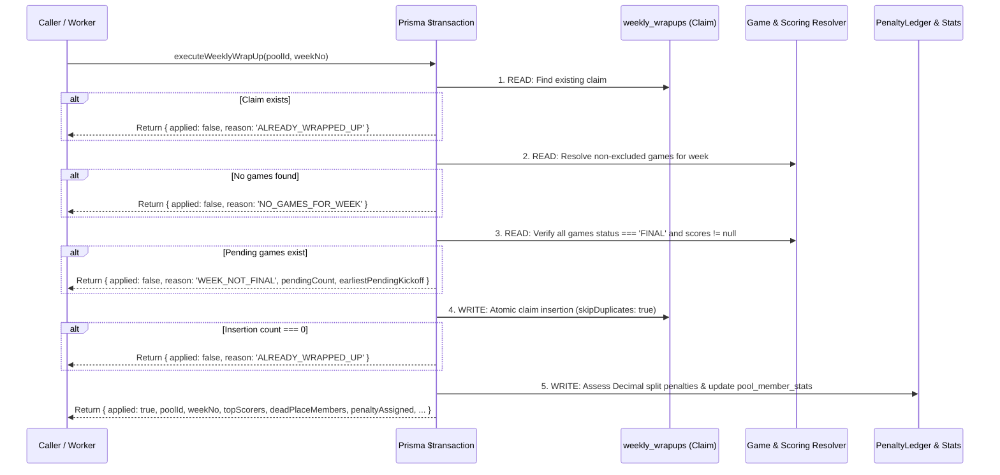

# Evidence Report: Senior Arbiter Ruling R-12.2-I

**Generated:** 2026-09-29T18:52:00-07:00  
**Environment:** Hosted PostgreSQL Database (`aws-0-us-east-1.pooler.supabase.com:5432`)  
**Status:** Weekly wrap-up preconditions, game finality checks, claim table idempotency, and pure Decimal math successfully implemented.

---

## 1. Game Resolution & Fallback Path Remediation

- **Code Location:** [`src/services/weeklyWrapUp.ts:114-142`](file:///c:/Users/kacone/Documents/AI%20and%20Tech/Antigravity/NFL%20Pick%20Em/src/services/weeklyWrapUp.ts#L114-L142)
- **Previous Unsafe Behavior:** The service previously queried picks for the pool and, if empty, fell back to `tx.game.findMany({ orderBy: { kickoffTime: 'desc' } })`, which could grab unassociated or non-weekly games database-wide.
- **Remediated R-12.2-I Behavior:**
  - Games are resolved from the pool's pick set and filtered against the shared `isGameInExcludedWindow(game.kickoffTime, excludedWindows)` resolver.
  - If `nonExcludedGames.length === 0`, the transaction strictly halts and returns `{ applied: false, reason: 'NO_GAMES_FOR_WEEK', poolId, weekNo }` without any fallback query.

---

## 2. Shared Function for "Excluded" Game Windows

- **Shared Resolver:** `isGameInExcludedWindow(kickoffTime: Date | string, excludedWindows?: string[]): boolean` defined in [`src/services/scoringEngine.ts:70-153`](file:///c:/Users/kacone/Documents/AI%20and%20Tech/Antigravity/NFL%20Pick%20Em/src/services/scoringEngine.ts#L70-L153).
- **Consumer Alignment:**
  1. **Scoring Engine:** [`src/services/scoringEngine.ts:208`](file:///c:/Users/kacone/Documents/AI%20and%20Tech/Antigravity/NFL%20Pick%20Em/src/services/scoringEngine.ts#L208) calls `isGameInExcludedWindow` during pick grading.
  2. **Wrap-Up Pre-Guard:** [`src/services/weeklyWrapUp.ts:130`](file:///c:/Users/kacone/Documents/AI%20and%20Tech/Antigravity/NFL%20Pick%20Em/src/services/weeklyWrapUp.ts#L130) calls `isGameInExcludedWindow` to filter out excluded games before evaluating week finality and tiebreaker games.
  3. **Wrap-Up Member Score Accumulator:** [`src/services/weeklyWrapUp.ts:203`](file:///c:/Users/kacone/Documents/AI%20and%20Tech/Antigravity/NFL%20Pick%20Em/src/services/weeklyWrapUp.ts#L203) calls `isGameInExcludedWindow` to ensure excluded games contribute 0 points to leaderboard totals.

---

## 3. Game Score Column Nullability & Status Guarantees

- **Schema Definition:** In [`prisma/schema.prisma:84-97`](file:///c:/Users/kacone/Documents/AI%20and%20Tech/Antigravity/NFL%20Pick%20Em/prisma/schema.prisma#L84-L97):
  - `homeScore`: `Int? @map("home_score")` (nullable in database)
  - `awayScore`: `Int? @map("away_score")` (nullable in database)
  - `status`: `GameStatus @default(SCHEDULED)` (`SCHEDULED`, `IN_PROGRESS`, `FINAL`)
- **Status Guarantee in Wrap-Up:**
  - Every resolved non-excluded game is checked:
    ```ts
    const pendingGames = nonExcludedGames.filter(
      (g) => g.status !== GameStatus.FINAL || g.homeScore === null || g.awayScore === null
    );
    ```
  - If `pendingGames.length > 0`, the transaction halts immediately:
    ```ts
    return {
      applied: false,
      reason: 'WEEK_NOT_FINAL',
      pendingCount: pendingGames.length,
      earliestPendingKickoff: sortedPending[0]?.kickoffTime ?? null,
      poolId,
      weekNo,
    };
    ```

---

## 4. Test Suite Inventory

- **Existing Tests:**
  - `src/db/test.ts`: Basic database connectivity and CRUD verification.
- **Wrap-up Test Impact:**
  - No automated test files currently run wrap-up against un-finalized games.
  - Future rehearsal tests in BR-0 will include test cases for:
    1. Rejection with `NO_GAMES_FOR_WEEK` when no games match the week.
    2. Rejection with `WEEK_NOT_FINAL` when at least one non-excluded game is `SCHEDULED` or `IN_PROGRESS`.
    3. Idempotent rejection with `ALREADY_WRAPPED_UP` on duplicate wrap-up attempts.
    4. Successful execution and Decimal split calculation when all games are `FINAL`.

---

## 5. Sequence of Execution Inside `$transaction`


